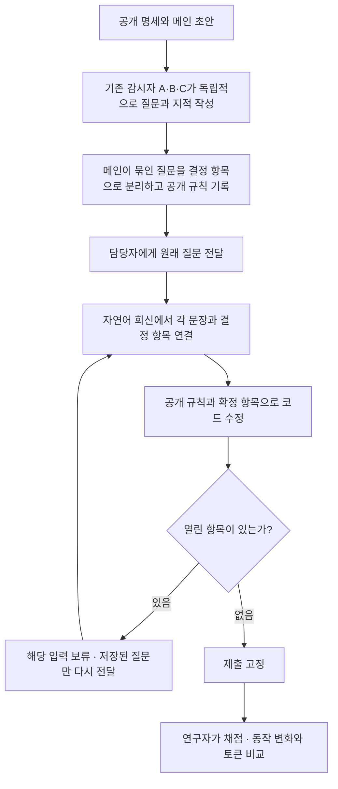

# 감시자의 질문은 언제 코드의 동작을 바꾸었나?

5조의 목표는 요구사항이 불충분할 때 AI가 운영 정책을 지어내는 일을 줄이는 것이다. 감시자가 두 정책의 결과가 갈리는 상황을 찾아 묻고, 담당자가 자연어로 답하면, 메인 모델이 그 답을 코드에 반영한다. 연구자는 제출을 고정한 뒤 채점하고 회차별 파일을 비교한다. 후기 실험에서는 정책 카드를 가진 Codex가 담당자 역할을 맡았다.

## 구조가 바뀐 이유

| 단계 | 무엇을 비교하거나 바꿨나 | 관찰과 다음 질문 |
|---|---|---|
| 초기 실행기와 멘토링 | 예약 취소·자원 배정에서 메인, 감시자, 사람의 개입을 연결했다. | 초기 완료 실행은 만점에 가까웠고 여러 조건이 한꺼번에 달랐다. 멘토 피드백과 5조 2차 발표 이후 자체 검토에도 질문 기회를 주고 성능·근거·비용을 함께 재기로 했다. [멘토 피드백](meetings/Team5_Mentor_Feedback.pdf) · [2차 발표](<meetings/5조_2차 미팅.pdf>) |
| 같은 초안에서 자체 검토와 독립 감시 | 메인이 세 관점을 순서대로 검토하는 조건과 세 감시자가 독립 검토하는 조건의 호출 수를 맞췄다. 별도 실험에서는 D가 A·B·C 의견을 요약하거나 실제 반환 경로를 추적했다. | 관점을 늘려도 이미 작성된 코드의 첫 반환을 잘못 읽을 수 있었다. [A·B·C 조건과 D 실험](../experiments/5조_멀티에이전트_실험_종합보고서.md) |
| 사람에게 최대 3회 질문 | 무질문 단독, 메인의 자체 검토·질문, 감시자의 검토·질문을 비교했다. 회차마다 질문과 실제 답, 코드, 토큰을 기록했다. | 예약·문의의 실제 3회차에서 자체 검토와 독립 감시의 총점은 73 대 62, 근거 있는 정답은 43 대 60이었다. 발견과 구현을 따로 추적할 이유가 생겼다. [100문항 분석](../experiments/pipeline100/README.md) |
| 모델과 과제 교차 | Qwen·Gemma·Phi 각각의 단독·자체 검토·동종 감시 3조건과 Qwen 메인·혼합 감시를 비교했다. | 모델·과제별 순위가 달랐다. 국소 편집기를 도입한 첫 전체 비교에서도 2,500개 문항·조건 쌍의 정오가 모두 같았다. [10조건 점수표와 실행 재사용 범위](../experiments/family-reply-delta-20261126/README.md) |
| 회신을 뒤집는 짝실험 | 같은 초안과 질문에서 답 한 문장을 반대로 주고, 해당 입력이 달라지는지와 주변 입력이 보존되는지를 검사했다. | 예약에서는 편집 적용이 실패했고 업로드에서는 경계에만 적용할 거부를 모든 양수에 적용했다. 인쇄에서는 같은 문답으로 들여쓰기·인용 처리를 고쳐 14/20에서 20/20이 됐다. [짝실험 보고서](pdf/학술제_후속실험_담당자_답을_뒤집은_짝비교.md) · [인쇄 고정 문답](../var/transfer-print-fixed-evidence-v1) |
| 질문과 답의 항목별 연결 | 초안·원래 질문 3개·지적 2개를 고정하고 업로드 상한 포함, 제외, 미언급을 비교했다. 이전 작성기는 미언급 시 16을 허용하고 1~15를 다시 물었다. | 질문을 보내기 전에 결정 항목과 공개 규칙을 고정했다. 회신의 모든 문장을 읽고 실제 답이 있는 항목만 닫자 16에서만 보류와 재질문이 발생했다. [이전 실행](../experiments/mixed-upload-three-answers-writer-20261126/received-policy-results.json) · [최종 결과](../experiments/ledger-receipts-20261126/results.json) |

## 현재 파이프라인

짝실험에서는 보류한 첫 코드도 고정해 두 벌로 복제했다. 같은 질문에 허용과 거부를 각각 답하면 두 코드 모두 한 줄만 바뀌었다. 실행 가능한 정수 비교식의 경계와 그 사이 구간을 검사해 두 제출의 동작 차이가 정확히 16 한 곳임을 확인했다.

| 업로드 첫 회신 | 15바이트 | 16바이트 | 17바이트 | 재질문 |
|---|---|---|---|---|
| 16 포함 | 허용 | 허용 | 거부 | 없음 |
| 16 제외 | 허용 | 거부 | 거부 | 없음 |
| 16 미언급 | 허용 | 보류 | 거부 | 16의 허용 여부 한 번 |

미언급 첫 제출은 실제 회신 기준 12/20에서 20/20으로 개선됐다. 표현을 바꾼 업로드에서도 같은 결과가 나왔다. 환풍기에서는 네 입력 조합 중 두 신호가 함께 있는 경우만 답에 따라 달라졌다. 이는 두 과제와 한 시드의 개발 검증이다. 환풍기 과제는 준비 단계의 질문 분류를 조정하는 데도 사용했다. 후기 회신 처리의 신규 호출 15회·3,164토큰은 이미 고정한 초안·감시·질문 준비 비용을 제외한 집계다. [질문 원장](../experiments/decision-ledger-20261126/agendas/upload/agenda.json) · [자연어 회신과 실제 제출 코드](../experiments/ledger-receipts-20261126/runs)
