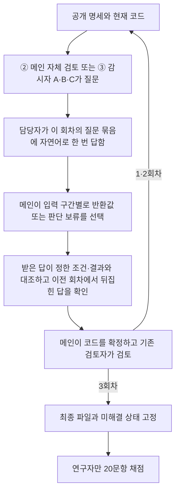

# 담당자의 답을 실제 반환값에 반영한 20문항 비교

같은 질문과 자연어 회신으로 작성 단계만 교체하자, 세 번째 제출에서 메인 자체 검토는 **12 → 13점**, 독립 감시자 A·B·C는 **14 → 15점**이 됐다. 예약에서 조건별 한 문항을 고쳤고 두 조건 모두 기존 정답을 모두 유지했다. 문의 배정은 두 조건 각각 10문항의 실제 반환값이 모두 같았다. [문항별 실제 반환값](research/items.csv) · [전후 코드 차이](research/code-changes.diff)

## 바뀐 한 단계

| 위치 | 기존 작성기 | 수정한 작성기 |
|---|---|---|
| 답을 받은 직후 | 담당자 문장을 모아 메인이 입력 구간마다 반환값과 근거 번호를 골랐다. 근거 번호를 붙인 분기도 답과 반대되는 값을 낼 수 있었다. | 원 질문과 회신을 회차별로 보관한다. 공개 명세가 정의한 입력 상태와 담당자가 명시한 동작이 함께 확인되면 해당 구간을 그 반환값으로 구현한다. |
| 다음 회차의 수정 | 같은 답을 다시 인용하면서 지난 회차와 반대되는 값을 선택할 수 있었다. | 같은 입력 구간에서 메인이 지난 회차와 같은 답을 다시 근거로 삼고도 반환을 뒤집으면, 담당자가 밝힌 이전 결과와 대조한다. 새 회신에 반대 결과나 해석할 수 없는 변경 사항이 있으면 보존을 강제하지 않는다. |



사람이 개입하는 곳은 회차마다 **질문을 받은 뒤, 메인이 수정하기 전**이다. ①은 같은 공개 명세로 한 번 작성한다. ②·③의 실제 운영에서는 다음 회차가 수정된 코드를 보고 질문한다. 이번 전후 비교에서는 작성기 효과를 분리하기 위해 과거 세 회차의 질문과 담당자 회신 12묶음을 고정했다. 대리 담당자는 당시 각 질문에서 요청한 정책을 고정 정책표에서 골라 자연어로 회신했다. 메인과 감시자에게 중간 점수나 비공개 정답이 전달되는 경로는 없다. [원 질문과 자연어 회신](../three-cycles-20261126/research/questions.md) · [실행 전 비교 조건](design.json)

## 무엇이 실제로 고쳐졌나

- **③ 예약 C082**. 담당자는 “이용이 시작되는 순간에는 정정 기간이 남아 있어도 거부합니다.”라고 답했다. 공개 명세에서 남은 시간 0초가 시작 순간이고 거부는 `False`다. 예약 후 300초, 시작까지 0초인 입력의 반환값이 `True → False`로 바뀌었다. 예약 후 정확히 600초인 같은 시작 순간 분기도 함께 고쳐졌다. 기존 600초·601초 구분은 두 문항 모두 정답이었다. 시작 **1초 후** 문항 C084의 정책은 이 조건이 받지 못했다. 그 문항은 오답으로 남았다. [실제 회신](../three-cycles-20261126/runs/reservation/multi/cycle-1/answer.json) · [최종 예약 코드](runs/reservation/multi/submissions/candidate/solution.py)
- **② 예약 C003**. 담당자는 2회차에 “일반 취소가 가능한 때에는 정정 기간이 끝났어도 일반 취소할 수 있습니다.”라고 답했다. 종전에는 메인이 3회차에 바로 그 답을 다시 인용하면서 이미 허용한 분기를 거부로 뒤집었다. 같은 분기에 새 근거가 없고 이번 회신도 허용을 설명해 이전 허용 결과가 유지됐다. 시작까지 86,401초인 이 문항의 최종 반환은 `False → True`다. [실제 회신](../three-cycles-20261126/runs/reservation/self/cycle-2/answer.json) · [최종 예약 코드](runs/reservation/self/submissions/candidate/solution.py)
- **문의 배정**. 메인이 담당자가 말한 우선순위를 이미 올바르게 구현한 분기는 그대로 통과했다. 두 조건 모두 마지막 제출에서 8/10이었다. [과제별 점수](research/by-project.csv)

## 감시자 조건에서 남은 5문항

예약에서 3개는 틀린 값을 반환했고, 문의 배정에서 2개는 판단을 보류했다. 정확히 24시간 전의 일반 취소(C011)는 경계 포함 여부를 회신받지 못한 채 거부했다. 이용 시작 1초 후의 정정(C084)은 감시자 B가 1회차에 질문까지 작성했지만 스스로 ‘질문 불필요’로 표시해 담당자에게 전달되지 않았다. 메인은 그 상황에서 허용을 반환했다. 일반 마감까지 1초 남은 예약(C003)은 정정 기간이 끝났다는 이유로 일반 취소까지 거부했다. ③은 두 규칙의 관계를 직접 확인하는 회신을 받지 못했고, 해당 거부 분기가 인용한 ‘두 기한이 모두 지남’도 이 입력에는 성립하지 않는다. 문의 배정 4·5번에서는 미등록 태그만 있는 입력과 빈 목록의 담당 팀을 회신받지 못해 둘 다 보류했다. [감시자 B의 원래 판단과 전달한 질문](../three-cycles-20261126/runs/reservation/multi/cycle-1/intake.json) · [실제 질문과 회신](../three-cycles-20261126/research/questions.md) · [문항별 반환값](research/items.csv)

받은 답의 적용 범위에도 누락이 있다. 담당자는 정정 시간이 예약을 생성한 때부터 10분이고, 정정 기간 안이면 일반 마감이 지나도 정정할 수 있다고 답했다. 최종 제출 후 같은 코드에 이용 시작까지 1시간 남은 예약을 넣어 확인했다. 예약을 만든 바로 그 순간에는 거부(17행), 1초 뒤에는 허용(27행)을 반환했다. 이 두 입력은 공식 20문항에 포함되지 않은 경계 확인이다. [담당자 회신](../three-cycles-20261126/runs/reservation/multi/cycle-1/answer.json) · [해당 분기](runs/reservation/multi/submissions/candidate/solution.py)

## 점수와 비용

모델은 Qwen3.5-4B Q4_K_M, 시드는 263이다. 표의 토큰은 두 과제에 들어간 **초안·질문·작성·제출 전 검토의 누적 합**이다. 동일 요청을 재사용한 경우에도 기록된 실제 입력·출력 토큰을 포함했다. [회차별 토큰과 호출](research/summary.csv)

| 조건 | 1회차 점수 전 → 후 | 2회차 점수 전 → 후 | 최종 점수 전 → 후 | 최종 오답 / 미판정 | 최종 누적 토큰 전 → 후 |
|---|---:|---:|---:|---:|---:|
| ① 메인 단독 | — | — | 10 → 10 | 8 / 2 | 1,625 → 1,625 |
| ② 메인 자체 검토 + 답변 | 8 → 8 | 8 → 8 | **12 → 13** | 5 / 2 | 24,787 → 24,801 |
| ③ 메인 + 감시자 A·B·C + 답변 | **14 → 15** | **14 → 15** | **14 → 15** | 3 / 2 | 55,266 → 55,121 |

②는 총 6개 질문, ③은 16개 질문을 두 과제에 걸쳐 각각 6묶음으로 전달했다. ②와 ③의 메인 작성 요청은 기존 12개 회차에서 각각 원본과 일치했고, 반영 확인에 추가한 모델 호출은 0회다. 달라진 토큰은 수정된 코드를 읽은 제출 전 검토에서 나왔다. 재생 과정에서 실제 새로 생성한 호출은 ② 1회·1,156토큰, ③ 9회·12,240토큰이다. 네 최종 제출 모두 미해결 상태(`open_limit`)로 기록됐다. 필요한 정책 회신 없이 값을 반환한 지정 문항은 6개 중 ① 5개, ② 4개, ③ 2개다. [실제 호출·분기·근거와 남은 문항](research/observations.json)

**적용 범위**. 직접 대조는 공개 명세와 회신에서 입력 조건과 결과를 명시적으로 연결할 수 있는 단일 함수의 지원되는 수치·목록 분기에 적용한다. 기간이나 기산점만 알려 준 회신은 일반 작성기에서 계속 사용한다. 복잡한 자유 서술, 자유 형식 코드, 여러 함수 사이의 의미 대응에는 기존 작성 모델의 해석이 여전히 필요하다. 자유 형식 작성과 짧은 긍정·부정 회신은 원래 질문 묶음을 함께 전달한다. 여러 질문에 대한 한마디 답이나 서로 충돌하는 결과는 자동으로 하나의 정책으로 확정하지 않는다. 다른 함수명·경곗값·반대 방향의 참/거짓 규약·복수 조건·새 회신이 기존 답을 수정하는 경우를 회귀 검사에 넣었다. 두 개발 과제와 시드 하나의 결과이므로 새로운 과제에서의 향상 폭은 아직 측정하지 않았다. [답과 분기를 대조하는 코드](../../backend/answer_contracts.py) · [회귀 검사](../../tests/test_answer_fidelity.py)

채점 전에 메인에 해석을 한 번 더 맡기는 예비안도 실행했다. 기간 설명에서 반환값을 추측하는 일이 작성 응답에 나타나 그 방법을 제외했다. 그 예비안에서 새로 생성한 27회·33,207토큰은 위 비교와 별도로 기록했다. [예비 작성 응답과 제출본](format-pilot/runs/) · [비교 기록의 식별값](research/manifest.json)

## 재현

일반 프로젝트는 기존 실행 명령으로 시작한다. 매회 출력된 질문에 답한 뒤, 그 회차 번호와 자연어 답변 파일로 재개한다. 기존 버전에서 시작한 실험은 당시 작성기로 재현한다.

```sh
python3 -B -m experiments.repeated_intervention 실행폴더 --project 공개명세.json --role multi --cycles 3
python3 -B -m experiments.repeated_intervention 실행폴더 --reply-to 1 --answer-file 1차답변.txt
```

이번 비교는 아래 두 명령으로 재현한다. 네 제출본이 모두 고정된 뒤에만 연구자 보고서가 생성된다. 일반 실행 진입점으로도 예약 자체 검토 3회차, 예약 감시자 1회차, 문의 배정 두 조건 각 3회차를 원본 모델 응답으로 재생해 질문 대기·자연어 답변 재개·제출 파일과 작성 기록이 일치하는지 확인했다.

```sh
python3 -B -m experiments.answer_fidelity_study run
python3 -B -m experiments.answer_fidelity_study report
```
