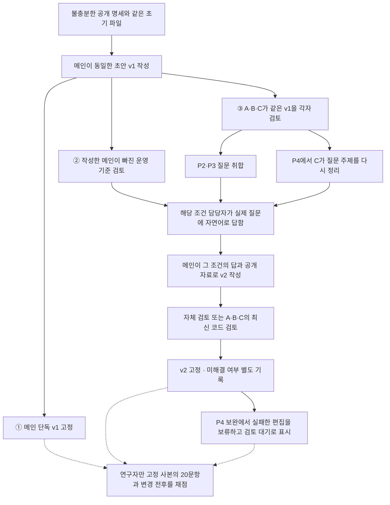

# 인간에게 묻는 멀티에이전트가 실제 코드를 바꾸는가

예약 취소 10문항과 문의 배정 10문항에서 메인 단독은 10/20, 메인 자체 검토도 10/20, 감시자 구조 세 가지도 각각 10/20이었다. 질문을 정리한 P4에서는 문의 배정이 4점에서 5점으로 올랐지만 예약 취소가 6점에서 5점으로 떨어졌다. 코드와 검증 기록을 읽은 뒤, 근거 확인에 실패한 새 편집을 보류하도록 수정했다. 같은 모델 출력을 재생하면 **11/20**이다. 단독 대비 새로 맞힌 한 문항은 빈 문의 목록 처리였다. [실제 모델 실행](research/results.md) · [20문항별 반환 결과](research/items.md) · [사후 재생의 파일 식별값과 판정](research/guarded.json)

| 비교 조건 | 예약 / 10 | 배정 / 10 | 정답 / 20 | 오답 | 미판정 | 입력 토큰 | 출력 토큰 | 총 토큰 |
|---|---:|---:|---:|---:|---:|---:|---:|---:|
| ① 불충분한 정보로 메인 단독 작성 | 6 | 4 | 10 | 8 | 2 | 738 | 887 | 1,625 |
| ② 메인이 자체 검토하고 담당자에게 질문 | 6 | 4 | 10 | 8 | 2 | 3,858 | 2,004 | 5,862 |
| ③ P2 독립 감시자 A·B·C 역할 분담 | 6 | 4 | 10 | 8 | 2 | 8,592 | 2,239 | 10,831 |
| ③ P3 감시자가 상황과 가능한 두 결과까지 기록 | 6 | 4 | 10 | 8 | 2 | 8,494 | 4,577 | 13,071 |
| ③ P4 감시자 C가 질문 정리, 메인이 답과 실행 줄을 연결 | 5 | 5 | 10 | 9 | 1 | 10,249 | 4,379 | 14,628 |
| ③ P4 출력에 수정 보류 규칙 적용 · 사후 재생 | **6** | **5** | **11** | **8** | **1** | **10,249** | **4,379** | **14,628** |

마지막 행은 P4의 작성·검토 비용을 전액 포함한다. 보류 규칙은 새 모델 호출 없이 동작했다. 연구자가 결과를 읽고 도입한 변경이므로 독립 반복 실험에서 재현되는지는 추가 검증이 필요하다. P2·P3·P4 및 자체 검토의 두 과제 모두 한 번의 답변·수정 후에도 열린 문제가 남았다. 위 수치는 정식 완료 승인과 별개로 마지막에 고정한 코드의 점수다. [발표용 통합 CSV](research/summary.csv) · [조건별 원자료 CSV](research/metrics.csv) · [재생 CSV](research/guarded.csv)

## 무엇을 같게 두었나

- 모든 작성과 검토에 **Qwen3.5-4B Q4_K_M** 한 모델을 사용했다. Qwen3-8B 예비 실행에서 문의 배정 양쪽의 수정본이 구문 오류로 16문항 모두 값을 반환하지 못한 기록이 있었다. 세대를 한 단계 올리고 파라미터 표기 규모는 8B에서 4B로 줄였다. 두 세대에 같은 실험을 반복한 모델 성능 비교는 이번 표본의 범위 밖이다. 로컬 파일은 배포자가 공개한 SHA-256과 일치한다. [Qwen 모델 카드](https://huggingface.co/Qwen/Qwen3.5-4B) · [실행한 양자화 파일](https://huggingface.co/lmstudio-community/Qwen3.5-4B-GGUF/blob/main/Qwen3.5-4B-Q4_K_M.gguf)
- 시드 263 하나, 같은 공개 명세, 파일, 양자화, 생성 설정, 담당자 정책, 그리고 과제별로 동일한 첫 메인 응답을 사용했다. 예약은 마감 전후, 정정 마지막 순간과 다음 초, 이용 시작 직전·정각·직후를 담았다. 배정은 단일·복수 태그, 순서 변경, 중복, 혼합, 빈 목록을 담았다. 과제는 2개, 서로 다른 채점 입력은 20개다. 독립적인 20개 개발 프로젝트를 수행한 실험과는 표본 단위가 다르다. [실행 전 선택한 문항과 지표](design.json) · [고정 입력의 식별값](manifest.json)
- ①은 첫 메인 호출 한 번으로 끝난다. ②·③은 첫 코드 → 검토 → 담당자 답변 창구 한 번 → 코드 수정 → 최종 검토까지 진행한다. 질문은 과제·조건당 최대 세 문장이다. 연구 진행자가 위임받아 해당 조건이 실제로 물은 항목에만 고정 정책의 자연어로 답했다. 막연한 평서문에는 구체화를 요청했다. 질문 수에는 이런 회신도 들어간다. 직접 참여한 실사용자의 정책 답변은 0회다. [질문별 회신 원문](operator)
- P2에서 A는 빠진 요구사항, B는 겹치는 규칙의 우선순위, C는 구현이 임의로 정한 동작을 읽는다. 같은 스냅샷을 각자 읽으며 서로의 답을 보지 않는다. P3는 같은 세 관점에서 상황·두 가능한 결과·질문을 작성한다. P4는 이 최초 감시 의견을 재사용하고 C가 묻는 주제를 다시 고른다. P1의 공통 관점 세 명 조건은 구현되어 있고 이번 소표본에서는 실행하지 않았다.
- 각 조건의 토큰은 로컬 추론 서버가 돌려준 입력과 출력을 합산했다. 정확히 같은 역할·메시지·모델·시드·양식·생성 설정을 재사용하면 각 단독 배치에서는 한 번씩 전액을 계상한다. 표에 대응하는 고유 호출은 46회, 33,874토큰이다. 물음표로 끝나는 문장만 통과시켜 간접 질문이 누락된 초기 P4 기술 점검에만 8회, 5,856토큰이 더 들었다. 이번 작업의 두 실행을 합친 중복 없는 비용은 54회, 39,730토큰이다. [역할별·회차별 호출 기록](research/comparison.json)

## 변경 전후와 사람이 개입하는 지점

기존 두 조건 예비 실행에서는 메인과 감시자가 모두 질문을 낼 수 있었다. 메인 단독으로 끝나는 조건이 없어 누가 부족한 정보를 발견했는지 비교하기 어려웠다. 새 실험에서는 코드 작성 권한은 메인에 두고 질문 권한을 조건마다 다르게 지정했다.



메인과 감시자는 코드 작성·검토 중 점수, 테스트 입력, 정답, 다른 조건의 회신을 볼 수 없다. P4의 재작성 기회는 새 답변을 받는 회차가 아니다. 이미 받은 답을 실행 줄에 연결한 기록이 기계적으로 성립하지 않을 때 같은 원문으로 한 번 더 작성한다. 실제로 예약은 두 번 작성했고 배정은 한 번 작성했다. 연구자는 최종 파일이 모두 고정된 뒤 v1과 v2 사본을 같은 문항으로 측정했다.

## 실제 코드에서 찾은 원인

**예약 취소에서 10분이라는 답이 사라졌다.** 자체 검토 조건은 “정정 시간은 예약을 생성한 때부터 셉니다”, “정정 가능 기간은 10분입니다”라는 두 문장을 받았다. 수정 후 코드의 본문은 초안과 같은 세 줄이다. `until_start_seconds < 0`이면 거부하고 그 밖에는 전부 허용한다. `age_seconds`는 인자로만 남았다. 같은 예약에서 600초가 지난 C071과 601초가 지난 C072 모두 `True`였다. 전자는 우연히 맞고 후자가 틀렸다. 정확히 이용 시작 시각인 C082도 허용했다. 첫 초안의 설명 문자열에는 실제로 받지 않은 “직원의 답변 (가정)”이 들어 있었다. [실제 담당자 회신](operator/reservation-self-v1.json) · [수정 전후 코드](runs/reservation/self/v2/snapshot.json) · [메인 자체 검토 최종 파일](runs/reservation/submissions/self/solution.py#L30)

**문의 배정에서 주석과 반복문의 동작이 달랐다.** P2는 “집합을 사용하여 … 순서를 무시”한다고 썼지만, 집합은 태그가 알려진 이름인지 검사할 때만 사용한다. 실제 반복문은 입력 순서대로 돌며 첫 번째 알려진 태그에서 즉시 반환한다. `[account, billing]`이면 `account`, 순서를 뒤집으면 `billing`이 나온다. 두 입력의 기대값은 모두 `billing`이다. 담당자에게 순서·중복 불변성은 확인했지만 어떤 팀이 우선하는지는 묻지 않았다. P3에서는 세 사람이 중복에 대한 비슷한 문장으로 질문 한도를 채웠고, 이미 찾아 놓은 미등록 태그·빈 입력 질문은 뒤로 밀렸다. [P2 반복문](runs/triage/submissions/p2/router.py#L10) · [P3의 전체 제안과 실제 전달 문장](runs/triage/p3/v1/review.json)

문의 배정의 메인 첫 응답은 JSON으로 읽혔지만, 그 안의 파이썬 파일 35번째 줄에 불필요한 `},`가 들어갔다. 구문 검사에서 편집을 보류해 여기에선 공개 초기 파일이 공통 초안이 됐다. ②의 다음 작성도 36번째 줄의 불필요한 `}` 때문에 보류됐다. 두 응답의 실제 토큰은 모두 비용에 포함했다. [첫 작성 원문](runs/triage/calls/056ed8257da1ceaeef266377791aa1cd20e595499ff7f7a2b6b2694cc09a19b6.json) · [자체 검토 수정의 구문 기록](runs/triage/self/v2/snapshot.json)

**P4는 빈 목록에 관한 답을 실제 분기로 바꿨다.** C가 질문을 정리한 뒤 담당자는 빈 목록을 `general`로 보낸다고 명시했다. 메인이 `if not tags: return 'general'`을 추가해 배정 5번이 미판정에서 정답으로 바뀌었다. 모르는 태그만 들어오는 4번은 끝의 예외로 빠진다. 이 조건이 받은 답은 빈 목록과 알려진 태그가 섞이는 경우까지였고, 모르는 태그만 있는 경우까지 정하지 않았다. 복수 팀 우선순위도 묻지 않아 순서 의존이 남았다. [담당자에게 도착한 세 문장과 답](operator/triage-p4-v1.json) · [P4 배정 코드](refined-v2/triage/submissions/p4/router.py#L2)

**P4 예약 수정에서는 공개 문서의 24시간이 잘못된 입력에 붙었다.** P4가 받은 운영 사실은 정정 시간을 예약 생성부터 잰다는 것이었다. 작성자는 `age_seconds >= 86400`과 `until_start_seconds >= 0`이면 거부하는 코드를 만들었다. 24시간은 공개 명세상 이용 시작까지 남은 시간에 대한 일반 취소 마감이다. 그 수치를 예약 생성 후 경과 시간에 옮길 근거가 없었다. C003·C011은 정상 취소를 거부했고, C084는 이용 시작 1초 뒤의 취소를 허용했다. 반대로 C002·C006은 새 분기 때문에 기대값과 우연히 일치했다. 총점만 보면 이 다섯 변화가 가려진다. [P4 예약 코드](refined-v2/reservation/submissions/p4/solution.py#L4) · [회차별 문항 전환](research/comparison.json)

**검증 실패 후에도 교체되던 파일을 그대로 둘 수 있게 고쳤다.** P4 예약의 두 번째 작성은 기존과 동일한 함수 선언을 바뀐 실행 줄로 인용했다. 원래 실행기는 검증 실패를 기록한 뒤 그 파일을 최종 후보로 써 버렸다. 보완 절차는 답변을 반영했다고 주장한 줄이 실제 동작을 바꿨는지 다시 확인한다. 함수 선언이나 설명 문자열만 인용하거나 검증에 실패한 편집은 이전 버전을 유지하고 재검토로 남긴다. 이미 구현됐다는 주장에 근거가 약하면 그 주장을 미확인으로 표시한다. 배정에서는 빈 목록에 대한 유효한 변경을 유지한다. 이 절차는 과제명, 변수명, 정답값, 점수를 읽지 않는다. [공통 적용 코드](../festival_guarded.py) · [예약 보류 기록](refined-v2/reservation/guarded/receipt.json) · [배정 적용 기록](refined-v2/triage/guarded/receipt.json)

목표인 임의 판단 감소도 별도로 확인했다. 담당자 답이 필요한 6개 지정 문항에서, 필요한 답을 다 받기 전에 코드가 결과를 반환한 경우는 단독 5개, 자체 검토 5개, P2 4개, P3 5개, P4 및 보완 재생 4개였다. 어떤 문장이 있어야 근거가 충분한지는 문항별로 실행 전 지정했다. 보완 후에도 근거가 부족한 판정이 4개 남아 있고, 이전 코드로 되돌리는 것만으로 기존의 잘못된 가정을 제거할 수는 없다. 다음에 같은 질문 예산으로 검증할 것은 “입력 순서를 바꿔도 같아야 한다”처럼 공개 명세가 보장하는 관계를 두 입력에 대입했을 때 동일한 실행 결과가 나오는지다.

## 재현

프로젝트 루트에서 실행한다. 담당자 회신은 각 과제·조건의 실제 질문과 함께 저장되어 있다. 일반 프로젝트의 새 질문에는 재사용 가능한 실행 명령의 `--answer-file`로 직접 답할 수 있다. 포트는 루프백에만 열린다.

```sh
python3 -B -m experiments.festival_mini run
python3 -B -m experiments.festival_mini pending
python3 -B -m experiments.festival_mini refine
python3 -B -m experiments.festival_mini report
```

수정 보류만 다시 확인할 때는 `python3 -B -m experiments.festival_mini guard-replay`를 쓴다. 이 재생은 파일 식별값이 일치한 기존 20문항의 실제 판정을 사용한다. 이번 실행 전체에서 사용한 프로토콜, 담당자 회신, 모델 원문, 중간·최종 파일은 로컬에 보관했다. [최초 비교 설계](design.json) · [P4 실행 전 변경 기록](refinement-v2-manifest.json) · [감사기의 JSON 배열 비교 수정 내역](audit-amendment.json)
