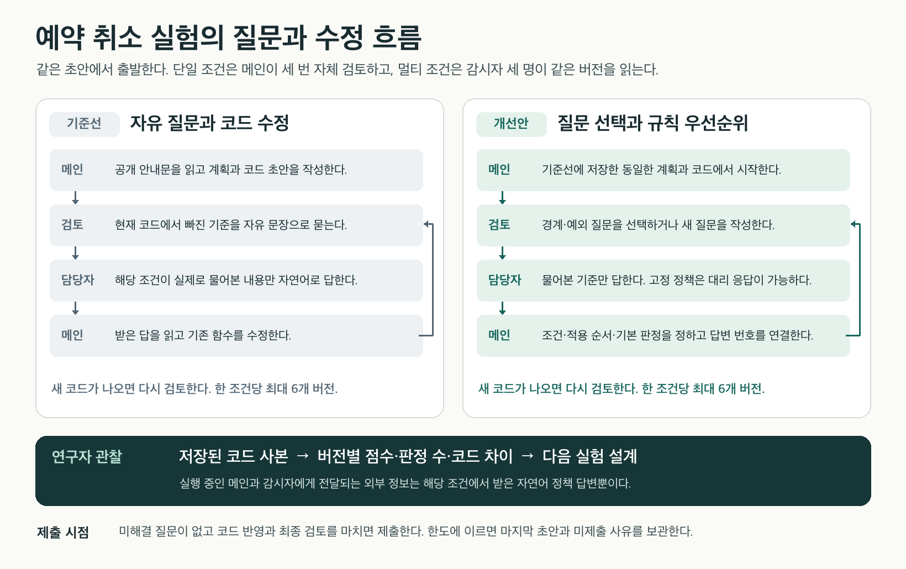

# 정보가 부족할 때 묻는 코딩 에이전트

기본 예약 취소 40문항에서, 검토자가 빠진 운영 기준을 찾아 담당자에게 묻고 메인이 그 답을 코드에 반영하는지 살폈다. 회의 자료 4·6쪽의 메인 한 명, 감시자 세 명, 제출 전 인간 개입 구조를 따랐다. 실제 실험의 답변은 사용자가 위임한 진행자가 고정 정책 카드에서 작성했다. 직접 사람에게서 받은 정책 답변 수는 0회다.

**자유 질문을 기준선으로 유지한다.** 답변 범위를 바로잡고 시드 157을 재실행했을 때 단일은 15/40점, 독립 감시자 세 명을 둔 조건은 20/40점이었다. 멀티에서 추가로 맞힌 다섯 문항은 감시자가 정정 기간을 물어본 다음 버전에서 생겼다. 여섯 정책을 모두 묻고 규칙 순서까지 명시한 방식은 둘 다 25/40점이었지만 15문항을 잘못 판정했다. 다음 개선은 확인된 기간의 단위·끝점·우선순위를 코드에서 보존하는 데 초점을 둔다. [전체 비교 수치와 코드 해시](human-intervention-comparison-20261126.json)

## 비교 조건

| 방식 | 검토자가 하는 일 | 답이 오면 메인이 하는 일 |
|---|---|---|
| 자유 질문 기준선 | 같은 계획과 코드에서 미정인 부분을 찾아 직접 질문한다. | 자기 조건에서 받은 답을 읽고 함수를 고친다. 답변 인용과 코드 한 줄을 별도로 적는다. |
| 질문 선택 + 코드 인용 | 공개 안내문에서 만든 마감 경계·기간·규칙 충돌 질문을 하나씩 검토한다. 필요한 질문만 보내며 자유 질문도 쓸 수 있다. | 받은 답에 번호를 붙이고 직접 쓴 함수의 해당 줄에서 인용한다. |
| 질문 선택 + 순서 있는 규칙 | 같은 질문 양식을 사용한다. 이미 답한 기간·끝점 질문의 한국어 표현도 중복으로 인식한다. | 입력·비교 기호·정수 초·허용/거부/미정·조건 순서·기본 판정과 인용을 정한다. 실행기는 그 순서 그대로 Python 함수를 출력한다. |

각 방식에 **단일 자체 검토**와 **메인 + 독립 감시자 3명**을 뒀다. 단일은 동일한 세 관점으로 차례로 자신을 검토하면서 직전 자체 검토도 읽는다. 멀티의 감시자는 다른 감시자의 의견을 보지 않는다. 담당자에게 물을 기회는 양쪽 모두 같다. 메인은 다른 조건의 답이나 감시자의 결론을 전달받지 않는다.

모델은 로컬 Qwen3-8B Q4_K_M, 버전당 최대 호출은 메인 한 번과 검토 세 번이다. 호출당 출력 한도는 메인 2,200토큰, 검토자 850토큰이며 조건당 최대 여섯 버전이다. 두 시드는 각각 기준선이 생성한 첫 호출 기록을 모든 비교에 복사해 동일한 초안에서 시작한다. 검토 양식과 이전 자체 검토의 길이에 따라 실제 사용 토큰은 다르다.

## 한 번의 수정에서 일어나는 일

1. **메인이 현재 코드와 계획을 저장한다.** 확정된 부분은 구현하고, 근거가 필요한 부분은 질문하거나 미구현 경로로 남길 수 있다.
2. **감시자가 같은 버전을 읽는다.** 공개 요구의 누락, 경계·예외, 근거 없는 가정과 답변 반영을 각자 검토한다. 구현을 직접 고칠 수 있는 지적은 내부 검토에 남긴다.
3. **실제 질문이 있으면 제출 전에 멈춘다.** 메인과 검토자가 낸 질문을 해당 조건 안에서 모으고 같은 문장은 합친다. 예를 들어 정정 기간의 마지막 순간을 물으면 포함 여부만 답한다. 기간의 길이는 그 길이가 질문에 포함됐을 때 답한다. 담당자의 직접 답변과 승인된 대리 응답은 기록에서 구분한다.
4. **해당 조건의 메인이 답변 원문으로 새 코드를 작성한다.** 새 버전에는 세 검토가 다시 붙는다. 새 질문이 생기면 다시 담당자에게 간다. 답변이 충분하지만 코드가 덜 완성됐으면 기존 자연어 근거로 재검토를 이어간다. 메인에게 검토자의 고칠 코드, 검사 결과, 점수를 넣어주지 않는다.
5. **제출 여부를 기록한다.** 메인의 완료 표시, 마지막 세 검토, 미해결 질문, 필요한 정책을 실제로 전달받았는지, 함수·인용의 형식과 미구현 경로를 확인한다. 한도에 걸리면 마지막 점수를 관찰값으로 남기고 미제출 처리한다. 인용된 코드가 담당자의 의도와 의미상 같은지는 연구자 채점에서 별도로 확인한다.

**연구자는 1번에서 저장되는 모든 코드를 볼 수 있다.** 별도 프로세스가 코드 사본을 채점하고, 형제 폴더에 버전별 점수·판정 수·정오답 변화·코드 차이를 쓴다. 그 기록을 보고 다음 파이프라인을 설계할 수 있다. 실행 중인 메인과 감시자의 입력은 각 조건의 원문 기록으로 재생할 수 있다. [연구자 관찰 코드](intervention_research.py) · [모델 입력과 대리 응답 재생 검사](intervention_audit.py)

## 기준선을 보존한 이유

이전 A·B·C·D 비교에서 A는 공개 문구를 해석하고 B·C·D는 차례로 코드를 고쳤으며 D가 마지막 시간 기준 검토를 맡았다. 담당자는 개입할 수 없었다. 같은 여섯 번 호출로 A·B·C·D는 411/480, 단일 자체 검토는 409/480이었다. 이후 공동 답변 예비 실험에서는 두 조건 모두 24 → 30 → 30/40이었다. 이 예비 실험에서는 한쪽의 질문으로 다른 쪽도 같은 정보를 받으므로, 검토자가 실제로 정보를 끌어내는 효과는 방식별 자유 질문 기준선에서 비교했다. [이전 A·B·C·D 비교](qwen3-public-clock-review-20261126/README.md) · [공동 답변 예비 실험](qwen3-human-intervention-20261126-research/overview.md)

## 첫 시드에서 막힌 지점

| 시드 131, 단일·멀티의 점수 동일 | 초안 | 2차 | 3차 | 4차 | 5차 | 6차 | 6차에서 판정한 문항 |
|---|---:|---:|---:|---:|---:|---:|---:|
| 자유 질문 기준선 | 14 | 24 | 24 | 24 | 24 | 24 | 25/40 |
| 질문 선택 + 코드 인용 | 14 | 24 | 24 | 24 | 24 | 24 | 25/40 |
| 질문 선택 + 순서 있는 규칙 | 14 | 20 | 29 | 35 | 35 | 35 | 40/40 |

- **초안에서 추측이 실제로 발생했다.** 메인은 예약 후 1초 이내면 취소를 허용했다. 당시 공개 안내에는 정정 시간이 있다는 설명만 있었다. 자유 질문으로는 여섯 결정 중 정정 시간의 길이와 일반 마감 이후 적용 여부만 알아냈다. 2차부터는 일부 담당자 답변을 다시 질문처럼 복사했다. [공통 초안](qwen3-scoped-intervention-20261126-131/round-001/multi/snapshot.json) · [기준선 버전별 점수](qwen3-scoped-intervention-20261126-131-research/overview.md)
- **답을 확보한 뒤에도 적용 순서에서 실패했다.** 두 조건 모두 질문 선택 양식에서 첫 묶음으로 여섯 결정을 확인했다. 그러나 메인은 시작 순간의 거부보다 정정 허용을 먼저 반환했고, 이미 답한 경로에도 미구현 예외를 남겼다. 질문의 충실도는 개선됐지만 직접 코드로 쓰게 한 조건의 점수는 24점에 머물렀다. [질문·답변 기록](qwen3-guided-intervention-20261126-131/state.json) · [두 번째 코드](qwen3-guided-intervention-20261126-131/round-002/multi/snapshot.json)
- **규칙 순서와 기본 판정을 명시하자 판정 범위가 넓어졌다.** 6차 코드는 기준선이 답하지 못한 15문항을 모두 맞혔고, 기준선에서 맞힌 4문항을 틀렸다. 순증은 11점이다. 2차에는 10분을 10초로 적었고, 3차에는 시간 단위를 고쳤지만 같은 입력이 동시에 86,400초와 같고 0보다 작아야 하는 조건을 남겼다. 4차에 그 모순이 풀렸다. 마지막까지 정정 허용을 이용 시작 순간보다 먼저 처리하는 문제가 남았다. [연구자용 점수와 변경 이력](qwen3-ordered-intervention-20261126-131-research/overview.md) · [3차에서 4차로 바뀐 코드](qwen3-ordered-intervention-20261126-131-research/round-004/multi/change.diff)

## 두 번째 시드와 질문 방식의 영향

아래는 최초 응답 규칙에서 나온 시드 157의 6차 코드다. 분모는 40문항이며 질문 범위를 바로잡은 재검증은 별도로 기재한다.

| 방식 | 단일 정답 | 단일 판정 수 | 멀티 정답 | 멀티 판정 수 | 전달된 핵심 정책 결정 수, 단일·멀티 |
|---|---:|---:|---:|---:|---:|
| 자유 질문 기준선 | 20 | 25 | 20 | 20 | 3/6 · 3/6 |
| 질문 선택 + 코드 인용 | 25 | 25 | 25 | 25 | 6/6 · 6/6 |
| 질문 선택 + 순서 있는 규칙 | 20 | 21 | 14 | 15 | 6/6 · 6/6 |

자유 질문에서 단일은 5개를 잘못 판정했고 멀티는 20개에 답을 보류했다. 멀티가 판정한 20개는 모두 맞았다. 순서 있는 규칙 방식은 여섯 결정을 모두 받았어도 서로 모순되는 조건과 미정 기본값을 남겼다. 처음의 두 시드와 세 방식 모두 6차 한도에서 미제출로 끝났다. 매 조건에 메인과 검토를 합쳐 24회 호출을 배정했으며, 공통 초안을 양쪽의 사용량에 각각 포함했다. 실제 사용 토큰은 단일 31,442~52,073, 멀티 27,434~44,975였다. [시드 157 자유 질문](qwen3-scoped-intervention-20261126-157-research/overview.md) · [질문 선택](qwen3-guided-intervention-20261126-157-research/overview.md) · [질문 선택과 규칙 순서](qwen3-ordered-intervention-20261126-157-research/overview.md)

## 대리 응답 범위를 다시 확인한 이유

시드 157의 첫 자유 질문에는 “일반 마감이 지난 예약과 막 이용이 시작된 예약에 대해서도 정정 요청을 받습니다. 이는 until_start_seconds의 어떤 범위에 해당하나요?”가 있었다. 처음 진행자는 앞 문장의 ‘마감’과 ‘정정’까지 판단에 써서, 접수 범위를 묻는 질문에 마감 뒤의 정정 허용 여부를 알려줬다. 같은 묶음에 이 운영 방침을 명시적으로 요청한 다른 질문도 없었다. [당시 멀티 질문과 대리 응답](qwen3-scoped-intervention-20261126-157/state.json)

새 실행은 문장별로 무엇을 묻는지 확인한다. 입력의 뜻, 정정 시간의 기산점, 기간의 길이, 허용 여부를 따로 처리한다. 답변을 복사한 평서문은 질문에서 제외하며, 어느 정책을 묻는지 불명확하면 자연어로 구체화를 요청한다. 담당자의 “구체적으로 말씀해 주세요” 같은 되물음은 대화 원문에 보존하고, 코드에서 허용·거부의 근거로 인용할 수 있는 문장 목록에서는 제외했다. 과거 기록은 당시 규칙으로 재생하도록 보존했다. 시드 157의 원래 첫 호출을 다시 사용한 별도 비교에서 두 수정을 함께 측정했다.

**자유 질문 재검증에서 감시자 한 명이 메인이 얻지 못한 근거를 확보했다.** 같은 초안에서 단일은 일반 마감의 경계만 확인했다. 마지막까지 15문항에 판정하고 15개를 맞혔다. 멀티의 첫 번째 감시자는 2회차에 정정 기간의 끝 경계를 물었고, 3회차에 “정정 가능 기간은 예약 생성 시각 기준으로 얼마나 지나야 하는가?”라고 물었다. 진행자는 묻지 않았던 첫 회차에 기간을 공개하지 않았고, 이 질문에 예약 생성 후 10분이라고 답했다. 메인은 4회차 코드에서 600초를 사용했고, 20문항에 판정해 20개를 맞혔다. 끝점 포함을 물어보고도 코드에 `< 600`을 쓴 문제는 남았다. [3회차 실제 질문과 제안자](qwen3-clause-free-20261126-157/round-003/multi/questions.json) · [4회차 코드](qwen3-clause-free-20261126-157/round-004/multi/snapshot.json) · [단일·멀티 점수 추이](qwen3-clause-free-20261126-157-research/overview.md)

| 시드 157, 응답 범위 수정 후 | 6차 정답 | 오답 | 미판정 | 답을 받은 핵심 결정 | 보낸 질문 / 받은 대리 답변 묶음 |
|---|---:|---:|---:|---:|---:|
| 자유 질문 · 단일 | 15 | 0 | 25 | 1/6 | 11 / 1 |
| 자유 질문 · 멀티 | 20 | 0 | 20 | 3/6 | 15 / 4 |
| 질문 선택 + 순서 있는 규칙 · 단일 | 25 | 15 | 0 | 6/6 | 19 / 2 |
| 질문 선택 + 순서 있는 규칙 · 멀티 | 25 | 15 | 0 | 6/6 | 19 / 1 |

규칙 순서 방식은 두 조건 모두 2차부터 25점을 기록했다. 멀티의 6차 코드에서는 ‘정정 기간이 지났고 이용 전이면 거부’가 ‘일반 취소 마감 전이면 허용’보다 앞에 있어, 정상적인 일반 취소도 거부했다. 자유 질문 멀티에 비해 틀리거나 보류했던 15문항을 맞히고, 이전에 맞힌 10문항을 틀려 순증은 5점이었다. 실제로 답변 인용은 갖췄지만 세 검토자가 모두 추가 수정을 요청해 최종 제출은 보류됐다. [연구자용 버전별 기록](qwen3-clause-ordered-20261126-157-research/overview.md) · [마지막 코드](qwen3-clause-ordered-20261126-157/round-006/multi/snapshot.json) · [마지막 검토](qwen3-clause-ordered-20261126-157/round-006/multi/review.json)

최초 비교 여섯 실행과 재검증 두 실행에서 저장한 모델 호출 기록 376개와 대리 답변 41묶음을 재생했다. 시드별 공통 초안을 다른 설계에 복사한 기록도 이 수에 포함된다. 메인·검토자의 실제 입력이 허용된 원문과 일치했고, 각 대리 답변도 그때의 진행자 규칙으로 재현됐다. 앞서 확인한 최초 응답 규칙의 과다 공개 사례는 별도로 표시했다. 이 여덟 실행의 단일·멀티 조건 16개는 모두 6차까지 진행한 뒤 미제출이었다. 점수는 해당 코드 사본의 관찰값이다.

## 다음 비교에서 바꿀 부분

1. **기준 시점과 단위를 답변에서 코드까지 보존한다.** 메인이 ‘예약 생성 후’, ‘10’, ‘분’과 담당자 원문을 함께 선택하고, 실행기가 단위만 초로 변환하는 조건을 현재의 정수 초 입력 방식과 비교한다. 답이 없으면 수치를 채울 수 없게 한다. 이 변경이 임의 숫자와 단위 변환 오류를 각각 얼마나 줄이는지 기록한다.
2. **서로 겹치는 규칙을 메인이 한 번 더 읽게 한다.** 두 규칙이 함께 성립하는 상황에서 먼저 적용할 규칙과 근거 문장을 메인이 적는다. 사람의 답이 부족한 충돌은 질문으로 되돌린다. 연구자의 실행 결과를 건네지 않고도, 모순된 시간 범위와 앞선 반환에 가려진 규칙을 찾아내는지 본다.
3. **새 과제에서 감시자 자체의 기여를 분리한다.** 이번의 여섯 질문은 예약 취소의 공개 안내를 보고 연구자가 미리 작성했다. 다른 과제에서는 ‘수치의 기준 사건’, ‘정확한 경계’, ‘규칙의 충돌’ 같은 관점만 양쪽에 똑같이 주고 실제 질문은 각자가 쓰게 한다. 같은 초안·예산에서 단일과 멀티의 새로 얻은 결정 수, 근거 없는 코드 분기, 정답·오답·미판정, 제출 여부와 담당자 질문 수를 함께 비교한다.

이 세 가지는 후속 비교 제안이다. 자동 질문 판독과 정책 수신 확인은 이 한국어 예약 과제에 맞춰 작성했다. 두 시드는 같은 40문항을 사용했다. 이번 측정의 정책 질의는 모두 승인된 대리 응답이어서 사람이 실제로 답하는 데 걸리는 시간과 피로도는 측정하지 않았다.
