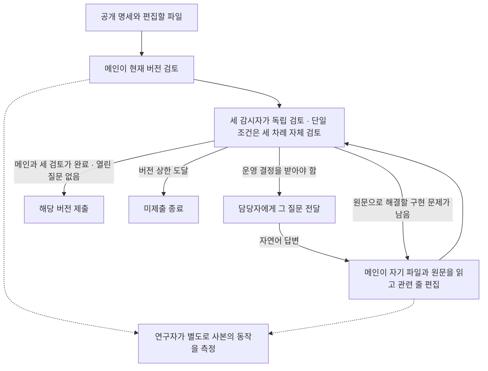

# 서로 다른 과제에서 같은 감시·질문 절차 검증

이 폴더는 Qwen3-8B 두 조건의 예비 실행이다. 문의 배정 두 조건에서 4차부터 들여쓰기 오류로 16문항 전부가 실행되지 않았다. 다른 일부 조건은 비교 설계가 바뀐 시점의 기록까지 보존했다. 아래의 후속 두 조건 전수 재실행은 진행하지 않았다. 학술제용 세 조건 및 실제 토큰 비교는 [핵심 20문항 실험](../festival-mini-20261126/README.md)에 기록했다.

## 실행 전에 정한 비교

예약 취소를 위해 만들었던 시간 변환기, 여섯 가지 질문 목록과 정답 정책 수신 여부 검사를 공통 경로에서 빼고, 공개 명세와 편집할 텍스트 파일만 받는다. 감시자들은 요구 누락, 규칙이 겹칠 때의 실행 순서, 인간 답변의 반영을 살핀다. 이미 받은 근거가 있으면 해당 코드 줄을 내부에 기록하고, 필요한 판단이 비어 있으면 자연어로 묻는다. 작성자는 공개 명세·자기 파일·자기 직전 계획·직접 받은 답을 바탕으로 근거가 있는 줄 범위만 고친다.

세 과제에서 시드 263, 메인 2,200토큰, 검토별 850토큰, 버전당 메인 한 번과 검토 세 번, 최대 여섯 버전을 고정했다. 메인과 세 검토 역할은 이 성능 비교에서 모두 같은 로컬 Qwen3-8B Q4_K_M을 쓴다. 단일 조건에서는 메인이 자신의 앞선 검토도 읽으며 세 번 검토한다. 멀티 조건에서는 세 감시자가 같은 파일을 독립적으로 읽는다. 모든 호출은 순서대로 실행한다.

예약 취소는 기존 40문항과 기존 263 실행의 첫 코드 그대로 시작한다. 기존 정책 전용 방식은 마지막에 단일 24 · 15 · 1, 멀티 29 · 10 · 1(정답 · 오답 · 미판정)이었다. 이번에는 첫 코드에서 내는 질문도 공통 절차가 직접 정하므로 과거 점수는 참고 기준이다. 새로운 과제는 문자열 하나를 반환하는 문의 담당 팀 배정 16문항, 문자열 리스트를 반환하는 표시 태그 병합 16문항이다. 두 묶음의 공개 명세, 진행자용 운영 규칙 및 평가 문항은 실행 전에 고정한다. 수치의 기준은 가장 마지막으로 검토한 버전이며, 제출 여부와 이전 정답에서의 퇴행도 기록한다.

진행자는 질문별로 고정 카드에서 요청한 항목을 선택해 자연어 원문만 회신한다. 공개 명세로 답할 내용은 그 문장을 사용할 수 있고 범위가 불명확하거나 기준이 비어 있으면 그대로 알린다. 질문별 선택 내역은 연구용 기록이다. 공통 실행기는 카드, 평가 문항, 과제 이름별 처리표를 받지 않는다.

## 상호작용과 정보의 출처

감시자는 구현상 충돌을 발견하면 실제 파일·줄과 해당 원문 번호를 기록한다. 이 기록은 내부에 보관한다. 메인은 자기 직전 계획, 현재 파일 및 받은 자연어 답으로 수정 내용을 정한다. 편집 범위가 겹치거나 유효한 원문 번호가 없으면 그 버전의 편집 묶음을 적용하지 않는다. 인용의 의미가 실제 코드와 맞는지는 감시자가 읽는다. 도메인은 입력으로 주는 텍스트에서 정해진다. [공통 지침과 편집 처리](../../backend/project_review.py) · [실행 및 호출 재생](../project_review.py)

세 과제의 첫 질문을 확인한 뒤 연구자용 보조 관찰도 추가했다. 과제별로 운영 결정이 필요한 상황 세 개를 고정하고, 각 회차에서 해당 답을 실제로 받기 전에도 코드가 판정을 반환하는지 기록한다. 이 지표는 전체 평가 점수와 별도다. 필요한 문장 목록은 관찰자가 정했으므로 개별 코드가 왜 그렇게 답했는지까지 판정하지 않는다. 보조 관찰 문항 (로컬 보관 자료)

## 공통 편집 검사를 추가한 비교 조건

첫 문의 배정 실행에서 단일과 멀티의 4차 편집이 모두 함수 안의 줄 하나에서 들여쓰기를 없앴다. 이후에는 16문항 모두 값을 반환하지 못했다. 또 표시 태그 검토에서는 공개 문장 전체가 질문으로 되돌아온 사례가 있었다. 두 관찰 뒤 후속 조건을 고정했다. 운영 정책·역할 지침·모델·출력 양식·예산은 그대로 두고 모든 과제에서 다음 두 동작을 적용한다.

- 편집한 파일을 실행하기 전에 해당 파일 형식의 구문을 읽는다. 원래 줄과 본문이 같고 들여쓰기만 달라져 구문이 깨졌다면 원래 들여쓰기를 복원해 다시 읽는다. 복원으로 고칠 수 없고 기존 버전의 구문이 유효했다면 그 회차의 전체 편집을 보류한다. Python·JSON·자바스크립트 구문을 지원하며, 다른 형식은 공통 텍스트 편집과 감시자 검토를 사용한다. 구문 결과와 연구 점수는 모델 입력에 추가하지 않는다.
- 질문으로 분류됐어도 이미 받은 평서문 한 줄과 그대로 같으면 내부 기록에 남긴다. 새로운 질문, 서로 충돌하는 원문 및 간접적인 추가 확인은 계속 담당자가 받을 수 있다. 이 필터만으로 완료 판정을 올리지 않는다.

각 과제·조건·회차·역할에서 모델에 보낼 요청 전체가 원래 요청과 바이트 내용상 같을 때만 원래 응답을 재사용하고, 하나라도 달라지면 로컬 모델을 다시 호출한다. 담당자 답변도 같은 조건·회차의 질문 묶음과 제안자가 일치할 때만 기존 선택을 사용한다. 재사용 및 새 호출 여부는 점수와 독립적으로 기록한다. [공통 구문 검사](../../backend/project_syntax.py)
