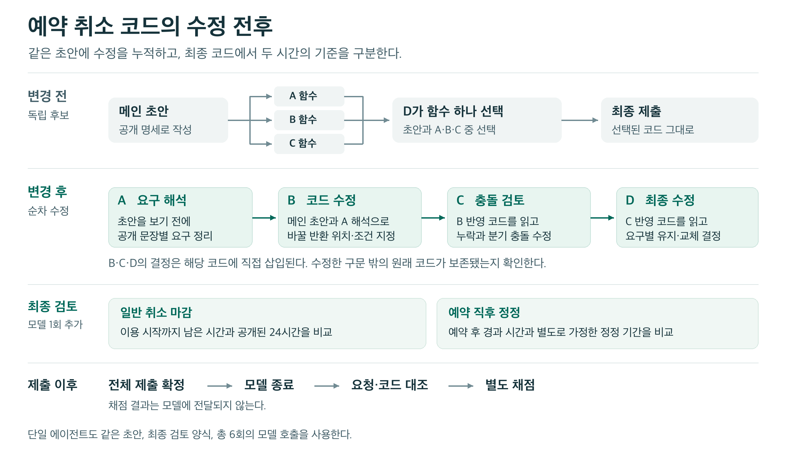

# 일반 마감과 예약 직후 정정을 구분한 A·B·C·D

이 기록은 담당자에게 질문할 수 없었던 이전 실험이다. 불충분한 정책을 찾아 사람에게 묻는 실험의 기준선, 수정 과정, 점수는 [사람이 개입하는 로컬 비교](../human-intervention-20261126.md)에 있다.

로컬 Qwen3-8B 한 모델을 사용했다. 비교하는 것은 같은 모델이 한 번에 제출하는 방식, 같은 개발자 역할로 끝까지 스스로 고치는 방식, 여러 역할을 나눠 같은 코드에 수정을 누적하는 방식이다.

**12개 시드 합계에서 최종 A·B·C·D는 단독 초안보다 기본 68점, 추가 입력 71점 높았다.** 같은 6회 호출의 단일 에이전트와 비교한 차이는 기본 2점, 추가 11점이었다. 기본 점수는 기존 6개 시드에서 단일 에이전트가 11점 앞섰고, 새 6개에서는 A·B·C·D가 13점 앞섰다.

| 방식 | 시드당 호출 | 기본 40문항 × 12 | 추가 56개 × 12 | 총 사용 토큰 |
|---|---:|---:|---:|---:|
| 단독 초안 | 1 | 343/480 (71.5%) | 512/672 (76.2%) | 7,136 |
| 단일 에이전트 자체 수정 | 5 | 338/480 | 476/672 | 86,868 |
| A·B·C·D 순차 수정 | 5 | 344/480 | 441/672 | 81,402 |
| 단일 에이전트 + 시간 기준 최종 검토 | 6 | 409/480 (85.2%) | 572/672 (85.1%) | 102,065 |
| **A·B·C·D + 시간 기준 최종 검토** | **6** | **411/480 (85.6%)** | **583/672 (86.8%)** | **97,561** |

| 시드 집단 | 단독 초안 기본 / 추가 | 최종 단일 기본 / 추가 | 최종 A·B·C·D 기본 / 추가 | 같은 6회 호출 간 차이 |
|---|---:|---:|---:|---:|
| 기존 6개 | 169 / 256 | 207 / 286 | 196 / 285 | −11 / −1 |
| 새 6개 | 174 / 256 | 202 / 286 | 215 / 298 | +13 / +12 |

집단별 만점은 기본 240점과 추가 336점이다. 최종 A·B·C·D와 최종 단일을 시드별로 짝지으면 기본은 4승·2무·6패, 추가는 5승·2무·5패다. 큰 향상은 두 방식에 공통으로 준 최종 검토에서 관찰됐다. 양식 도입과 호출 1회 추가의 효과는 이 비교에서 분리하지 않았다. [시드·조건별 점수](results.json) · [정오답이 바뀐 건수와 시드별 비교 집계](comparisons.json)



## 왜 최종 검토가 필요했나

1. **후보 선택에서 빠진 요구**. 이전 독립 후보 18개 중 1개는 잘렸고, 읽을 수 있는 17개 모두 예약 후 경과 시간을 판정에 사용하지 않았다. 12개는 주석과 함수 설명을 제외하면 초안과 같은 구조였다. D는 네 후보 중 하나를 고를 수 있을 뿐이었다. [이전 방식의 코드와 성적](../qwen3-blind-abcd-20261126/README.md)
2. **함수 전체를 다시 쓸 때 바뀐 단위**. 순차 수정으로 바꾼 첫 방식에서도 시드 131의 B가 ‘24시간’을 ‘24초’로 작성했다. 원본 보존 방식에서는 메인 초안의 특정 반환문을 골라 조건만 추가하고, 공개 수량은 단위를 보존해 참조하도록 바꿨다. C는 B의 코드, D는 C의 코드와 변경 사유를 직접 받는다. 실제 수정 구문을 제거해 원래 코드 구조가 복원되는지도 확인한다. [시드 131의 전체 규칙표](../qwen3-serial-revisions-20261126/131/serial/changes.json) · [원본 보존 방식](../qwen3-source-revisions-20261126/README.md)
3. **단위가 맞아도 기준점이 달랐던 오류**. 같은 시드의 원본 보존 방식에서 D는 ‘이용 시작 24시간 전’에 관한 수치를 ‘예약 후 24시간 정정 가능’으로도 사용했다. A는 정정 기간이 공개되지 않았다고 이미 기록해 두었다. 이 불일치는 채점 전 소스와 변경 사유만으로 확인했다. [A의 해석](../qwen3-source-revisions-20261126/131/serial/A.json) · [D가 반영한 조건과 이유](../qwen3-source-revisions-20261126/131/serial/changes.json)

## 최종 검토에서 모델과 프로그램이 맡은 일

| 공개 문구 | 프로그램에 고정한 의미 | 모델이 결정하고 기록하는 부분 |
|---|---|---|
| 일반 취소 마감은 이용 시작 24시간 전 | 시작까지 남은 시간과 원문에서 환산한 86,400초를 비교 | 정확히 마감 순간까지 허용하는지 |
| 이용이 시작되면 일반 취소 마감 | 시작까지 남은 시간이 0이 되는 순간부터 일반 취소가 닫힘 | 예약 직후 정정 예외도 이 순간에 닫히는지 |
| 방금 잘못 예약한 고객에게는 별도의 정정 시간 | 예약 후 경과 시간과 별도의 양수 기간을 비교 | 미공개 정정 기간의 값·단위, 기간 끝의 포함 여부, 시작 이후 적용 범위 |

마지막 검토는 기본 예약 취소 과제의 공개 문장을 사람이 구조화한 양식이다. 모델은 현재 코드와 앞서 적은 가정을 읽고 양식에 최종 결정과 근거를 기입한다. 프로그램은 각 결정을 실행되는 비교식으로 옮기고 요구별 코드 행을 기록한다. 모델이 스스로 숨은 기간이나 우선순위를 알아냈다고 가정하지 않는다. 단일 에이전트에도 동일한 양식과 코드 변환기를 제공한다. [공개된 필드와 고정 설계](design.json) · [최종 판단을 함수로 옮기는 코드](../policy_finalization.py)

## 코드와 판정이 실제로 얼마나 바뀌었나

- **최종 검토 24건 전부 반영**. 12개 시드에서 두 방식이 각각 작성한 결정 24건을 원문으로부터 재구성했다. 전부 저장된 코드 및 반영 행과 일치했다. 형식 미완료는 0건이었다. 추가 56개 입력에서 시작까지 남은 시간을 고정하고 예약 후 경과 시간만 바꿨을 때 판정이 달라진 시드는 단독 초안 0/12개, 원본 보존 A·B·C·D 10/12개, 최종 A·B·C·D 12/12개였다. [재구성 검증](integrity.json) · [고정 제출 코드](submissions.json)
- **고친 문항과 잃은 문항**. 단독 초안에 비해 최종 A·B·C·D는 기본에서 오답 106건을 고치고 정답 38건을 잃었다. 추가 입력에서는 124건을 고치고 53건을 잃었다. 같은 6회 호출의 단일 에이전트와 비교하면 각각 33건 개선·31건 악화, 49건 개선·38건 악화였다. [입력별 짝비교 집계](comparisons.json)
- **같은 호출 수에서 차이가 난 유형**. 기본의 ‘예약 직후 유예’는 단일 65/120에서 A·B·C·D 75/120으로 10점 높았다. 반면 평일 마감 1점, 마감 경계 5점, 시작과 유예의 우선순위 2점이 낮아 합계 차이는 2점이었다. 정정 기간과 정확한 경계의 근거가 공개되지 않아 최종 가정은 시드에 따라 달랐다.
- **같은 공개 원문에서 다른 결정이 나온 예**. 새 시드 353에서 단일 에이전트는 정정 기간을 1시간으로, D는 10분으로 가정했다. 나머지 최종 선택은 같았고 성적은 각각 기본 34/40·추가 44/56, 기본 39/40·추가 52/56이었다. 기존 시드 131에서는 양쪽 모두 5분을 골랐지만 정확한 마감 순간과 시작 순간의 선택이 갈렸다. 이때 기본은 단일 34/40, D 29/40이었다. [353 단일 결정](353/self/contract-receipt.json) · [353 D 결정](353/serial/contract-receipt.json) · [131 단일 결정](131/self/contract-receipt.json) · [131 D 결정](131/serial/contract-receipt.json)

## 평가 조건

- **공평한 호출 수**. 단독 초안은 1회다. 5회 시점은 공통 초안 이후 단일 개발자가 계획·재검토·최종 수정까지 한 코드와 A·B·C·D의 코드를 비교한다. 6회 시점에는 두 방식 모두 최종 검토를 정확히 한 번 추가한다. 공통 초안의 출력 상한은 1,500토큰, 이후 모든 호출은 각각 1,152토큰이다.
- **측정 단위**. 같은 초안에서 출발한 기존 6개 시드와 새 6개 시드를 따로 집계한다. 40개 기존 문항과 이들과 겹치지 않는 56개 추가 입력은 모든 시드에서 반복 사용했다. 새 시드 결과는 같은 과제에서 모델 생성의 변동을 본 것이다.
- **가채점 차단**. 원본 보존 단계는 제출만 확정하고 이어서 최종 검토를 실행했다. 각 단계가 읽는 것은 공개 문구, 이전 모델 응답과 코드뿐이다. 최종 검토 대상은 점수와 무관하게 전 시드와 두 방식으로 고정했다. 모든 제출을 고정하고 모델 서버를 종료한 뒤 요청 원문과 제출 코드를 재구성해 검증하고 채점했다. 따로 종료한 전체 규칙표 비교에서 가져온 자료도 최초 초안과 A의 공개 명세 해석뿐이다.
- **실제 기록 순서**. 서울 시간 11월 26일 01시 42분 55초에 원본 보존 단계 제출 72개가 고정됐다. 01시 45분 31.586초에 마지막 모델 응답, 31.587초에 최종 비교 제출 60개가 저장됐다. 두 단계의 최초 채점 파일은 그 뒤인 31.909초에 생성됐다. 최종 비교가 이어받은 모델 응답 108개의 내용도 원본과 일치했다. [이전 호출 해시](shared-inputs.json) · [최종 검증 기록](integrity.json)
- **통합 실행 재현**. 별도 폴더에 원문 응답 132건과 공개 설계만 복사해 아래 통합 명령을 다시 실행했다. 새로운 모델 호출은 차단했다. 두 단계 제출이 모두 고정된 시점에 채점 파일이 없음을 확인했고, 다시 채점한 60개 결과와 입력별 짝비교 집계가 원 실행과 모두 일치했다.

## 재현

프로젝트 루트에서 다음 한 명령으로 초안부터 최종 검토와 사후 채점까지 실행할 수 있다.

```sh
python3 -B -m experiments.monitor_cycles --public-clock-revisions experiments/새비교폴더
```

이번 비교처럼 원본 보존 단계와 최종 검토를 각각 다른 폴더에 보관하려면 첫 명령에 `--serial-revisions --seal-only`를 사용하고, 그 폴더를 두 번째 명령의 `--finalize-source`에 전달한다.
