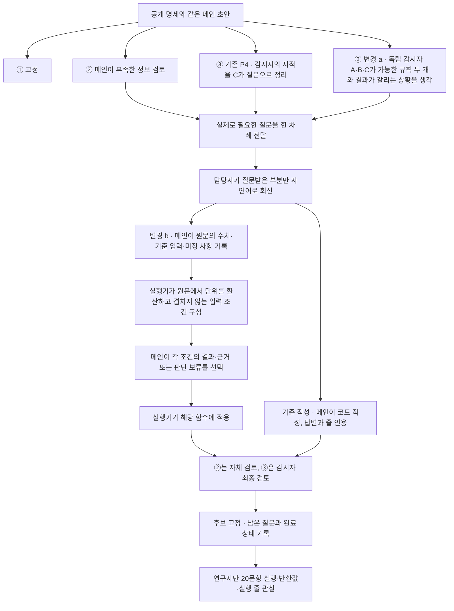

# 능동 추론으로 더 잘 묻고, 받은 답을 실행 조건에 반영하는 실험

같은 로컬 Qwen3.5-4B Q4_K_M, 시드 263, 예약 취소 10문항과 문의 배정 10문항으로 두 변경을 비교했다. **a**는 감시자가 질문을 만드는 방식을 바꾼다. **b**는 메인이 이미 받은 답을 코드로 옮기는 방식을 바꾼다. 같은 질문 조건에 속한 작성 방식들은 초안, 질문, 담당자 답변 원문을 공유한다. 작성 형식들끼리는 첫 규칙 메모의 실제 모델 응답까지 공유한다. 사전 설계 (로컬 보관 자료) · 기존 20문항 선정 기준 (로컬 보관 자료)

**두 변경을 결합한 조건은 14/20이었다.** 메인 단독은 10/20, 직전 감시자 기준선은 11/20이었다. 기준선에서 새로 맞힌 7문항과 정답을 잃은 4문항이 있었다. 순증 3점은 문의 배정에서 나왔다. 예약 총점은 6/10으로 같았지만 맞힌 문항이 달라졌다. 20문항별 실제 반환값 (로컬 보관 자료) · 조건 사이의 개선·퇴행 문항 (로컬 보관 자료)

| 조건 | 예약 /10 | 배정 /10 | 정답 /20 | 오답 | 미판정 | 필요한 답 없이 반환 /6 | 질문 | 입력 토큰 | 출력 토큰 | 합계 |
|---|---:|---:|---:|---:|---:|---:|---:|---:|---:|---:|
| ① 메인 단독 | 6 | 4 | 10 | 8 | 2 | 5 | 0 | 738 | 887 | 1,625 |
| ② 메인 자체 검토 + 답변 | 6 | 4 | 10 | 8 | 2 | 5 | 2 | 3,858 | 2,004 | 5,862 |
| ② 같은 자체 질문·답변 + b | 5 | 3 | 8 | 5 | 7 | 4 | 2 | 5,365 | 3,194 | 8,559 |
| ③ 직전 P4 기준선 | 6 | 5 | 11 | 8 | 1 | 4 | 6 | 10,249 | 4,379 | 14,628 |
| ③ a만 · 새 질문 + 기존 작성 | 6 | 4 | 10 | 8 | 2 | 2 | 5 | 8,141 | 5,509 | 13,650 |
| ③ b만 · 기존 질문 + 새 작성 | 5 | 4 | 9 | 5 | 6 | 3 | 6 | 12,002 | 5,521 | 17,523 |
| **③ a+b · 새 질문 + 새 작성** | **6** | **8** | **14** | **4** | **2** | **2** | **5** | **10,512** | **5,805** | **16,317** |

‘필요한 답 없이 반환’은 사전에 지정한 정책 의존 문항 6개에서, 그 조건에 필요한 사실을 모두 전달받기 전에 실행 코드가 결과를 반환한 수다. 미판정은 정답 0점으로 집계했다. a+b의 두 미판정은 문의 태그가 비어 있거나 전부 미등록인 경우다. 기존 질문에는 빈 목록의 답이 있었고 새 질문에는 없었다. 두 프로젝트 모두 마지막 검토에서 추가 확인이 남아 정식 완료 상태를 얻지 못했다. 전체 조건의 점수와 토큰 (로컬 보관 자료) · 질문·응답·실행 줄과 완료 상태 (로컬 보관 자료)

각 행에는 공통 초안을 포함해 그 구조를 독립 실행했을 때 필요한 실제 모델 호출의 토큰을 전액 잡았다. a+b는 두 과제에서 18회 호출과 16,317토큰을 사용했다. 직전 P4보다 1,689토큰(11.5%) 많았고 담당자에게 보낸 질문은 6개에서 5개로 줄었다. 전체 실험에서 동일 요청의 실제 응답을 재사용했다. 다른 조건과 겹치는 호출을 한 번만 세면, 신규 후보·검토에 연결된 호출 74개 75,596토큰, 초기 양식 실험에만 쓰인 신규 호출 4개 3,676토큰, 기존 기록에서 가져온 호출 28개 21,828토큰이다. 세 비교군의 총 토큰 예산은 서로 달랐다. 과제별 토큰과 상태 (로컬 보관 자료) · 실제 호출 비용 구분 (로컬 보관 자료)

## 변경 전후와 인간의 개입 시점



각 조건에서 사람이 개입하는 시점은 **공통 초안을 검토한 뒤, 수정 코드를 쓰기 전**이다. 이 비교에서는 과제별로 최대 세 질문을 한 묶음으로 보내고 한 번 수정했다. 마지막 검토가 새 의문을 남기면 `open_limit`으로 기록한다. ①은 첫 작성에서 끝난다. 실제 사람의 직접 응답은 0회였고, 사용자가 위임한 진행자가 사전에 고정한 담당자 정책에서 질문에 해당하는 문장만 자연어로 전달했다. 감시자의 후보 규칙과 사후 정답·실행 결과를 메인에 전달하는 경로는 없다. 실제 예약 질문과 답 (로컬 보관 자료) · 실제 배정 질문과 답 (로컬 보관 자료)

## a · 가능한 규칙을 비교해 질문을 고른다

A는 모호한 운영 기준을, B는 규칙이 충돌하는 상황을, C는 빠진 입력과 상태 변화를 본다. 각자 공개 명세와 같은 초안에서 서로 다른 두 해석과 그 해석들이 다른 결과를 내는 상황을 만든다. 담당자가 받는 것은 실제 운영 기준을 묻는 문장이다. 가설의 예시는 질문에 포함될 수 있다. 메인은 담당자 회신과 공개 원문을 근거로 구현한다. 이 방식은 초기 실험에서 1시간 같은 미공개 기간을 감시자가 직접 채택했던 문제를 피하려고 도입했다. [감시자 코드](../rule_intake.py) · [예전 1시간 가정이 남은 원기록](../qwen3-candidate-abcd-20261125/README.md)

| 과제 | 직전 P4가 확보한 정보 | 능동 추론을 쓴 감시자가 확보한 정보 |
|---|---|---|
| 예약 | 정정 시간의 기산점. 일반적인 질문에는 구체적인 상황을 다시 요청받음 | 기산점, 10분, 끝점 포함, 이용 시작 순간 거부, 일반 마감 뒤 정정 허용, 두 기간이 모두 끝나면 거부 |
| 문의 배정 | 순서·중복 불변, 알려진 태그와 섞인 미등록 태그 처리, 빈 목록의 팀 | 복수 태그의 명시적 우선순위, 미등록 태그 혼합 처리, 세 태그가 모두 있는 한 상황의 팀 |

새 질문에서는 예약의 정확한 일반 마감과 시작 직후, 문의 배정의 빈 목록을 따로 확인하지 않았다. 구체적인 질문을 늘리는 데도 한 묶음의 기회비용이 있었다. 질문·답변 고정 기록 (로컬 보관 자료)

## b · 실행 전에 반영이 끊긴 곳

1. **근거가 가리킨 줄이 동작을 결정하지 않았다.** P4는 입력 순서를 바꿔도 같아야 한다는 답을 받았고 함수 선언을 근거로 인용했다. 실제 반복문은 입력 순서대로 처음 만나는 태그를 반환했다. 빈 목록 처리 한 줄은 별도로 실제 적용됐다. 종전 P4의 실제 코드 (로컬 보관 자료)
2. **올바른 메모가 올바른 실행식으로 이어지지 않았다.** 메인 메모에 이용 시작 24시간 전과 `until_start_seconds`가 적혔지만 일반 코드로 쓴 비교식은 `>= 21600`이었다. 별도의 답에서 정정 10분을 정확히 읽어도, 생성기를 자유 조건식으로 바꾸자 공개된 24시간을 예약 경과 시간에 붙이는 일이 다시 생겼다. 실제 메모와 일반 코드 (로컬 보관 자료) · 시간 변수가 뒤섞인 조건식 (로컬 보관 자료)
3. **응답을 더 길게 써도 실행 코드가 남지 않는 경우가 있었다.** 기존 줄 단위 양식은 들여쓰기와 이스케이프 표기를 틀렸다. 일반 코드 양식의 두 예약 호출에서는 모델이 출력 한도에 닿아 이전 초안을 유지했다. 자유 조건식에서는 수치 입력에 목록 연산을 적용하거나 구문을 끝내지 못했다. 각 시도의 원문과 실패 결과를 보존했다. 첫 양식 실험 (로컬 보관 자료) · 일반 코드 응답 (로컬 보관 자료) · 자유 조건식 결과 (로컬 보관 자료)

최종 b는 원문에 적힌 수치를 메인 메모의 입력에 연결하고 그 입력 단위로 환산한다. 수치형 참·거짓 함수에서는 두 경계 사이와 경계 그 자체를 서로 다른 영역으로 표현한다. 순서와 중복이 결과에 영향을 주지 않는다고 명시된 목록에서는 알려진 값의 개수와 미등록 값의 공존 여부로 구분한다. 명시적인 우선순위가 있을 때 그 순서대로 처음 존재하는 값을 고르는 연산을 제공한다. 메인이 각 영역에서 반환값·원문 또는 판단 보류를 선택하면 실행기는 선택 그대로 함수 본문을 작성한다. 범위 밖 프로젝트는 일반 코드 작성 경로를 이용한다. 메인의 입력 연결, 정책 해석, 인용의 의미에는 오류가 남을 수 있어 최종 검토와 연구자의 사후 추적을 별도로 기록한다. [공통 입력 구분](../../backend/decision_regions.py) · [메인 작성과 인간 개입 진입점](../region_cycle.py)

## 같은 답변이 어디까지 코드가 되었나

| 실제로 받은 규칙 | a만 · 기존 작성의 실제 결과 | a+b · 새 작성의 실제 결과 |
|---|---|---|
| 정정 10분, 마지막 순간 포함, 일반 마감 후에도 허용 | 이용 한 시간 전 예약 경과 600초·601초 모두 허용 | 600초 허용, 601초 거부. 각각 예약 코드 37줄과 47줄에서 반환 |
| 복수 태그는 privacy → billing → account 순 | account·billing 두 태그의 입력 순서를 뒤집으면 account와 billing으로 갈림 | 양쪽 모두 billing. 복수 팀 우선순위 대표 네 문항 모두 정답. 배정 코드 7줄에서 원문 순위를 사용 |
| 이용 시작 순간에는 정정 기간이 남아도 거부 | 예약 후 300초·이용 시작 정각에 허용 | 같은 입력에서 여전히 허용. 담당자의 거부 문장 H4를 인용한 행에서 메인이 True를 선택하고 예약 코드 25줄이 그대로 반환 |

예약 코드에는 공개 일반 마감의 반대쪽에서도 같은 값을 반복 선택하는 문제가 남았다. 예약 후 600초가 넘었지만 이용까지 86,401초가 남은 C003은 일반 취소가 가능한데 51줄에서 거부한다. 정확히 24시간 남은 C011과 이용이 이미 시작된 C084는 필요한 세부 답이 없는 상태에서 판정까지 내렸다. 예약의 남은 오답 네 개 중 C082는 명시적인 담당자 답과 정반대이며, C003은 공개 일반 규칙을 어겼다. 예약 최종 코드 (로컬 보관 자료) · 메인이 인용한 원문 번호와 선택 (로컬 보관 자료) · 문의 배정 최종 코드 (로컬 보관 자료)

같은 능동 질문·답변에서 완전한 함수 코드를 자유롭게 쓰게 한 조건도 10/20이었다. 자유 조건식 양식은 두 과제 모두 유효한 첫 분기를 만들지 못해 0/20, 미판정 20개였다. 미판정 증가만으로 임의 반환을 줄인 방식은 채택 근거가 되지 않는다. 새 질문에서 작성 방식만 바꿨을 때 10→14점이었고, 새 작성 방식을 고정하고 질문만 바꿨을 때 9→14점이었다. 각 단독 변경은 직전 P4 점수보다 낮았다. 형식 실험을 포함한 모든 조건 (로컬 보관 자료) · 실행 줄 추적과 비교 (로컬 보관 자료)

후속 검증의 우선순위는 **확정된 예외를 정반대로 구현한 행을 검토자가 제출 전에 식별하는지**다. 예컨대 이미 “시작 순간 거부”라는 답이 있으면 검토자가 원문, 해당 입력 조건, 메인이 고른 반환값을 나란히 대조하고 메인이 그 부분만 다시 작성하는 회차를 비교할 수 있다. 새 정책이 필요한 행만 담당자에게 돌린다. 이번 실험은 수정 1회에서 끝났으며 이 추가 회차의 성능은 측정하지 않았다. 두 언어권 표현과 다른 단위·항목 이름을 사용한 소프트웨어 검사는 공통 코드의 동작 범위를 확인한다. 다른 프로젝트에서의 모델 성능은 별도의 맹검 표본이 필요하다.

## 재현

새 과제는 공개 명세와 작업 파일을 담은 JSON으로 시작한다. 일반 프로젝트의 담당자는 실제 질문이 출력된 뒤에 답변 파일을 전달한다. 같은 실행 폴더를 사용하면 최초 요청과 답변의 대응이 보존된다.

```sh
python3 -B -m experiments.region_cycle experiments/새프로젝트 --project 공개명세.json --role multi
python3 -B -m experiments.region_cycle experiments/새프로젝트 --answer-file 담당자답변.txt
```

같은 진입점에서 `--role solo`와 `--role self`도 지원한다. 보관된 비교는 프로젝트 루트에서 다음 순서로 재생한다. 연구자는 모든 조건의 코드와 실제 모델 요청을 대조한 뒤에 점수를 계산한다.

```sh
python3 -B -m experiments.rule_cycle_study run
python3 -B -m experiments.rule_cycle_study program
python3 -B -m experiments.rule_cycle_study regions
python3 -B -m experiments.rule_cycle_study report
```

질문 방식과 두 처리 요인은 먼저 등록했다. 일반 코드, 자유 조건식, 입력 영역의 구체적 형식은 새 점수를 열기 전에 소스와 출력 실패를 읽고 순차적으로 고정했다. 최종 표는 같은 개발 표본을 다시 측정한 결과다. 새로운 과제에서의 성능과 시드 간 분산은 이번 실험에서 측정하지 않았다. 질문 설계 (로컬 보관 자료) · 자유 조건식 고정 기록 (로컬 보관 자료) · 입력 영역 방식 고정 기록 (로컬 보관 자료)
