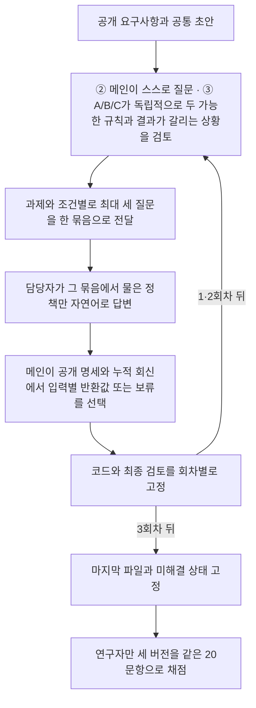

# 한 번 물었을 때와 세 번 물었을 때

예약 취소 10문항과 문의 배정 10문항에서 기존 1회차를 그대로 두고 두 차례 더 질문하고 수정했다. 주 비교는 같은 경로의 **1회차와 3회차**다. 메인 단독은 같은 최초 작성본을 한 번 평가했다. 메인 자체 검토 조건과 독립 감시자 조건에는 같은 횟수의 답변 기회를 줬다. [실행 전에 고정한 설계](design.json) · [출발점인 1회차 비교](../rule-cycle-20261126/README.md)

**③ 감시자 조건은 14 → 14 → 14점이었다.** 두 과제 모두 세 버전의 실제 파일 내용이 동일했다. 추가 질문 11개와 실제 모델 호출 32회에 38,949토큰을 더 사용했다. **② 메인 자체 검토는 8 → 8 → 12점**으로 변했다. 문의 배정에서 다섯 문항을 새로 맞혔고 예약에서 기존 정답 한 문항을 잃었다. [회차별 점수와 토큰](research/summary.csv) · [문항별 개선·퇴행](research/transitions.csv)

| 조건 | 회차 | 예약 /10 | 배정 /10 | 정답 /20 | 오답 | 미판정 | 필요한 답 없이 반환 /6 | 이번 질문 | 누적 입력 토큰 | 누적 출력 토큰 | 누적 합계 |
|---|---:|---:|---:|---:|---:|---:|---:|---:|---:|---:|---:|
| ① 메인 단독 | 초안 | 6 | 4 | 10 | 8 | 2 | 5 | 0 | 738 | 887 | 1,625 |
| ② 메인 자체 검토 | 1 | 5 | 3 | 8 | 5 | 7 | 4 | 2 | 5,365 | 3,194 | 8,559 |
| ② 메인 자체 검토 | 2 | 5 | 3 | 8 | 5 | 7 | 4 | 2 | 10,680 | 6,170 | 16,850 |
| ② 메인 자체 검토 | **3** | **4** | **8** | **12** | **6** | **2** | **4** | **2** | **16,366** | **8,421** | **24,787** |
| ③ 독립 감시자 | 1 | 6 | 8 | 14 | 4 | 2 | 2 | 5 | 10,512 | 5,805 | 16,317 |
| ③ 독립 감시자 | 2 | 6 | 8 | 14 | 4 | 2 | 2 | 5 | 23,932 | 11,854 | 35,786 |
| ③ 독립 감시자 | **3** | **6** | **8** | **14** | **4** | **2** | **2** | **6** | **38,144** | **17,122** | **55,266** |

②와 ③은 두 과제 모두 매 회차 실제 질문을 보냈고 회신을 받았다. 각 조건에 답변 묶음은 총 6개씩이다. 그 안의 질문은 ②가 6개, ③이 16개였다. 각 행의 누적 토큰에는 첫 초안, 질문, 메인의 계획·작성, 마지막 검토가 모두 들어 있다. 1회차는 보관된 실제 호출 비용을 포함한다. 2·3회차는 조건별 새 로컬 호출이다. 세 번째 검토 후 네 후보 모두 추가 확인이 남은 상태로 고정됐다. 미판정은 정답에 포함하지 않았다. [과제·회차별 비용과 상태](research/by-project.csv)

## 한 회차에서 오가는 것



첫 회차는 보관된 실제 초안·질문·담당자 회신·작성·검토 요청을 재구성했다. ③에서는 이전 14점 조건, ②에서는 같은 작성기를 쓴 이전 8점 조건이 출발점이다. 두 번째·세 번째 회차는 직전 파일과 **그 조건이 지금까지 받은 자연어 회신**으로 질문 단계를 새로 실행했다. 감시자끼리 가설을 공유하거나 메인이 감시자의 추측을 받아 정책으로 사용하는 경로는 없다. 마지막 소스 검토에서 나온 추가 질문은 기록에 남긴다. [반복 실행 코드](../repeated_intervention.py)

역할이 보는 관점과 질문 양식, 메인의 작성기, 로컬 모델 Qwen3.5-4B Q4_K_M, 시드 263, 샘플링 설정과 고정 담당자 정책은 공통이다. 추가 회차에서도 역할별 시드를 유지하며 로컬 모델을 실제로 호출한다. 회차 도중 중단됐다가 재개하면 그 회차에서 이미 끝난 동일 요청의 출력을 재사용한다. 담당자 답변은 사용자가 위임한 진행자가 고정 정책에서 골랐다. 일반 프로젝트에서는 실제 담당자가 답한다. 질문이 없는 창구에서는 답변을 추가하지 않는다. [모델·정책·초기 코드 고정 기록](manifest.json)

## 담당자의 세 번째 답이 달라질 기회가 있었나

예약에서 감시자들은 2회차에 두 기간이 모두 끝난 경우와 정정 마지막 순간을 물었다. 3회차에는 다시 정정 시간의 기산점·끝점·일반 마감과의 관계를 물었다. 이들 답은 모두 1회차에 이미 받은 문장이었다. 계속 남아 있던 정확한 일반 마감 순간과 이용 시작 직후의 정책은 새로 요청하지 않았다.

문의 배정의 감시자들은 2회차에 account와 billing이 같이 있을 때의 담당 팀을 구체적으로 물었다. 추가된 문장은 “account와 billing만 겹치면 billing 팀으로 보냅니다”였다. 이 결과는 1회차에 받은 privacy → billing → account 순위로도 결정할 수 있었다. 3회차는 같은 조합과 미등록 태그의 혼합을 되물었다. 빈 입력과 미등록 태그만 있는 입력의 담당 팀은 묻지 않았다.

메인 자체 검토에서는 다른 일이 일어났다. 예약 2회차에는 정정 시간이 끝난 뒤 일반 취소가 여전히 가능한 조건을 물었다. 문의 배정 2회차의 출력은 코드 누락을 지적하는 평서문이어서 진행자가 구체적인 상황을 물어 달라고 답했다. 3회차에 메인이 여러 팀이 겹치는 정책을 명시적으로 물었고, 그때 고정 우선순위를 전달했다. [질문·답변 전문](research/questions.md)

## 코드에서 확인한 효과

- **③ 예약**은 세 번 모두 정정 600초와 601초를 구분했지만, 예약 후 300초에 이용이 이미 시작되는 정각에는 취소를 허용했다. 1회차에 받은 “시작 순간에는 거부”와 충돌하는 동작이 끝까지 남았다. 추가 회신은 기존 원문의 반복이었고, 중복 문장을 한 번만 쓰는 작성기에서 세 회차의 규칙 계획·반환값 선택 요청은 실제로 같은 내용이었다. 같은 로컬 시드로 각 회차를 다시 실행해 같은 코드를 얻었다. 정확히 일반 마감인 경우와 이용 시작 직후는 필요한 답을 얻지 못한 채 판정한 두 지정 문항이다. [최종 예약 코드](runs/reservation/multi/submissions/candidate/solution.py) · [실행된 줄과 근거 충족 여부](research/observations.json)
- **③ 문의 배정**은 세 번 모두 8/10이었다. 2회차에 새 문장이 들어가 작성 요청은 달라졌지만, 일반 우선순위가 이미 그 조합을 포함해 반환 코드는 같았다. 빈 목록과 미등록 태그만 있는 두 입력은 계속 미판정이었다. ③의 두 과제를 합쳐 2회차의 문자 그대로 새 회신은 한 문장, 3회차는 0문장이었다. [회차별 문항 반환값](research/items.csv)
- **② 문의 배정**은 3회차에 처음으로 복수 팀 순위를 물었다. 담당자 회신을 받은 뒤 메인은 입력에 존재하는 태그 중 privacy, billing, account 순으로 선택하는 두 분기를 추가했다. 이전에 보류한 6·7·9·11·15번을 모두 맞혀 3/10에서 8/10이 됐다. ② 예약에서는 정정 기간이 끝났어도 일반 취소가 가능한 상황의 분기를 허용에서 거부로 바꿔 C003을 잃었다. C003은 이용까지 86,401초가 남아 있다. [세 회차에서 실제 바뀐 코드 전체](research/code-changes.diff)

이 표본에서는 ③의 첫 질문이 복수 팀 우선순위를 확보한 것이 이득이었고, 두 번 더 질문해도 판정을 바꿀 정책을 새로 얻지 못했다. 다음 비교 후보는 **최대 3회**까지 허용하면서, 후속 질문이 기존 답으로도 결과가 갈리는 새로운 상황을 제시하는지 확인하는 방식이다. 이미 답이 있고 코드가 그와 충돌하면 해당 분기의 수정과 검토에 시간을 쓴다. 이 조건부 운영의 비용과 효과는 이번 고정 3회 실험에서 측정하지 않았다.

이번 수치는 기존에 사용한 두 개발 과제·시드 하나의 짝지은 관찰이다. 비용은 실제 사용량이며 총 토큰 예산을 동일하게 제한하지 않았다. 세 번째 제출을 모두 고정한 뒤 연구자만 채점했고, 일반 프로젝트 실행 진입점에서도 보관된 동일 모델 요청과 자연어 답으로 네 최종 후보의 파일을 재현했다. [채점 결과와 재현용 식별값](research/manifest.json)

## 재현

일반 프로젝트는 공개 `brief`와 파일별 텍스트가 있는 `files`를 사용한다. 매회 출력된 질문을 확인하고 실제 회차 번호와 자연어 답변 파일을 넘기면 다음 회차로 진행한다. 두 번째와 세 번째 질문의 실제 발생 여부에 맞춰 답한다.

```sh
python3 -B -m experiments.repeated_intervention experiments/반복실행 --project 공개명세.json --role multi --cycles 3
python3 -B -m experiments.repeated_intervention experiments/반복실행 --reply-to 1 --answer-file 1차응답.txt
python3 -B -m experiments.repeated_intervention experiments/반복실행 --reply-to 2 --answer-file 2차응답.txt
python3 -B -m experiments.repeated_intervention experiments/반복실행 --reply-to 3 --answer-file 3차응답.txt
```

`--role self`로 메인 자체 검토를, `--role solo`로 한 번만 작성하는 기준선을 실행할 수 있다. 보관된 학술제 비교를 재생할 때는 프로젝트 루트에서 아래 두 명령을 사용한다. 네 최종 후보를 모두 고정한 뒤에만 연구자 보고서를 만든다.

```sh
python3 -B -m experiments.three_cycle_study run
python3 -B -m experiments.three_cycle_study report
```
