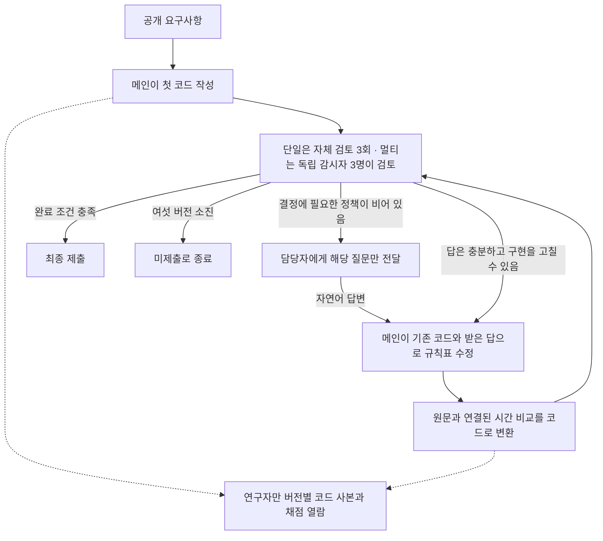

# 담당자 답변의 시간 조건을 코드에 보존하는 비교

**기존 규칙표를 쓰고, 검토 직전에 그 표의 시간 조건만 담당자 원문과 대조하는 방식을 후속 후보로 남긴다.** 시드 263의 독립 감시자 조건은 기존 25개에서 29개를 맞혔고 오답은 15개에서 10개로 줄었다. 단일 자체 검토는 양쪽 모두 24개를 맞혔다. 같은 초안에서 메인이 원문을 직접 고르는 양식까지 바꿨을 때는 단일 20개, 멀티 16개였다. 모두 여섯 번째 코드 사본을 연구자가 측정한 값이다. 자유 질문 기준선은 기본 실행으로 보존했다. [짝지은 전체 수치·문항별 변화 개수](threshold-comparison-20261126.json)

## 결과를 보기 전에 고정한 조건

이전 자유 질문 기준선과 순서 있는 규칙 실험을 그대로 보존했다. 시드 157의 자유 질문 단일·멀티는 각각 15/40점과 20/40점, 순서 있는 규칙 단일·멀티는 각각 25/40점이었다. 두 규칙 방식에서 실제로 판정한 문항은 40개였고 오답은 15개였다. 여섯 번째 코드까지 공식 제출 조건을 충족한 조건은 없었다. [이전 보고서](human-intervention-20261126.md) · [기준선 측정 원본](human-intervention-comparison-20261126.json)

| 보존한 파일 | SHA-256 |
|---|---|
| 이전 보고서 | `6569d15a2ddeaa86ee173161ad32b810ac2d8992244e1fa03e77a4db1020f898` |
| 기준선 측정 원본 | `b10aee3d14a18b37383f33fdc3bb447fb9d7db77ac28b0e0b3773065eeb4d288` |

이번 변경의 직접 대조군은 같은 질문 양식을 쓰는 순서 있는 규칙 방식이다. 시드 157의 저장 기록과 미리 선택한 새 시드 263을 사용한다. 시드 안에서는 첫 메인 호출을 공유한다. 모델, 질문을 받을 기회, 진행자 카드 사용 권한, 질문 양식, 세 검토와 여섯 버전의 상한을 유지한다. 바꾸는 곳은 메인이 둘째 버전부터 시간 조건을 표현하는 방식이다.

주요 관찰값은 마지막 코드의 정답·오답·미판정, 제출 여부, 대조군이 맞혔던 문항의 퇴행이다. 연구자가 이전 실행을 보고 설계한 시드와 새 시드의 결과를 각각 기록한다. 비교 시점은 각 조건이 마지막으로 검토한 코드로 고정했다.

## 원문을 선택하도록 양식을 바꾼 결과

각 칸은 같은 40문항에서 **정답 · 오답 · 보류** 개수다. 오답은 허용이나 거부를 반환했지만 틀린 경우이고, 보류는 함수가 판단을 반환하지 않은 경우다. 점수는 정답 하나당 1점이다. 양쪽 모두 여섯 번째까지 검토했고 공식 제출 조건을 충족한 실행은 없었다. 같은 시드·방식끼리 첫 메인 호출 원본, 첫 질문 묶음과 그 자연어 답변이 일치했다. 후속 회차의 질문과 답은 해당 실행에서 실제로 발생한 것을 썼다.

| 시드와 검토 방식 | 기존 규칙표 | 원문을 선택하는 양식 | 정답 변화 | 기존 정답이 오답이 된 수 |
|---|---:|---:|---:|---:|
| 157 단일 자체 검토 | 25 · 15 · 0 | 25 · 9 · 6 | 0 | 5 |
| 157 독립 감시자 3명 | 25 · 15 · 0 | 25 · 9 · 6 | 0 | 5 |
| 263 단일 자체 검토 | 24 · 16 · 0 | 20 · 5 · 15 | −4 | 4 |
| 263 독립 감시자 3명 | 25 · 15 · 0 | 16 · 24 · 0 | −9 | 20 |

263 단일의 정답 수는 차례로 **14 → 35 → 35 → 5 → 20 → 20**, 멀티는 **14 → 16 → 20 → 16 → 35 → 16**이었다. 263 멀티는 대조군의 오답 11개를 맞혔지만 기존 정답 20개를 틀렸다. 마지막 코드에서 메인은 ‘이용 시작까지 24시간 이하’라는 같은 조건을 두 번 검사한 뒤 곧바로 허용을 반환했다. 두 방식 모두 첫 질문 묶음에서 이미 핵심 정책 여섯 가지를 받았다. 이 실험에서는 그 뒤의 반복 수정이 이전에 맞던 일반 취소와 예외의 적용 순서를 보존하지 못했다. [시드 157의 매 회차](qwen3-source-thresholds-20261126-157-research/overview.md) · [시드 263의 매 회차](qwen3-source-thresholds-20261126-263-research/overview.md) · [263 멀티의 최종 검토 코드](qwen3-source-thresholds-20261126-263/round-006/multi/snapshot.json)

## 기존 규칙표를 유지한 실제 재검토

아래의 동일 행 재생을 살펴본 뒤 시드 263에서 추가했다. 대조군과 첫 질문·답변이 같았고, 첫 수정의 메인 요청과 메인이 실제 돌려준 규칙표도 단일·멀티 양쪽에서 각각 완전히 일치했다. 이 시점부터는 변환된 코드를 각자의 검토자들이 읽고, 다음 메인이 그 버전을 받아 다시 작성했다. 이 방식의 실시간 검증은 시드 263 한 개에서 수행했다.

| 시드 263 | 기존 규칙표의 정답 · 오답 · 보류 | 시간 대조 후 정답 · 오답 · 보류 | 시간 대조 후 1~6차 정답 수 |
|---|---:|---:|---|
| 단일 자체 검토 | 24 · 16 · 0 | **24 · 15 · 1** | 14 → 24 → 24 → 24 → 24 → 24 |
| 독립 감시자 3명 | 25 · 15 · 0 | **29 · 10 · 1** | 14 → 29 → 29 → 29 → 29 → 29 |

멀티에서는 ‘예약 직후 유예’의 오답 5개가 정답이 됐고 ‘시작과 유예 우선순위’의 기존 정답 1개가 보류로 바뀌었다. 단일에서는 오답 1개가 보류로 바뀌었다. 양쪽 모두 기존 정답에서 오답으로 바뀐 문항은 0개였다. 각각 24회 호출했고, 멀티는 17개 질문에 대리 답변 한 묶음, 단일은 13개 질문에 두 묶음을 받았다. 두 방식 모두 마지막 세 검토가 추가 수정을 요구해서 미제출로 끝났다. [버전별 코드 성적과 질문 수](qwen3-bound-ordered-20261126-263-research/overview.md) · [원문과 비교식의 연결 기록](qwen3-bound-ordered-20261126-263/round-006/multi/time-conditions.json) · [마지막 검토](qwen3-bound-ordered-20261126-263/round-006/multi/review.json)

다음에 바꿀 한 곳은 **겹치는 규칙의 순서**다. 마지막 멀티 코드에는 '이용 시작 순간이면 보류'하는 앞선 분기가 같은 순간을 거부하는 다음 분기를 가리는 경우가 있다. 일반 취소가 허용되는 시간에도 정정 기간이 지났다는 이유로 먼저 거부하는 분기도 남았다. 감시자가 동시에 성립하는 두 조건과 인용된 답을 짝지어 확인하고, 답에 이미 우선순위가 있으면 해당 행만 고치게 하는 것이 다음 비교의 대상이다. 담당자에게는 우선순위를 결정할 근거가 비어 있는 경우에만 묻는다. [두 분기를 포함한 실제 코드](qwen3-bound-ordered-20261126-263/round-006/multi/snapshot.json)

## 변경한 시간 조건

| 이전 | 변경 후 |
|---|---|
| 메인이 입력 변수, 정수 초, 비교 기호를 각각 생성한다. | 메인이 출처가 붙은 시간 표현과 비교 방향을 고른다. 시간 표현은 해당 입력에 묶여 있어 ‘예약 생성 후’와 ‘이용 시작까지’의 숫자를 서로 바꿔 쓸 수 없다. |
| 행의 인용 목록에 정책이 있어도 숫자와 비교 기호는 독립적이다. | 실행기는 원문의 단위를 한 번만 초로 환산한다. 그 행이 인용한 문장이 동일한 경계의 포함·제외 또는 정확한 시각의 허용·거부를 명시하면 비교식에 반영한다. |
| 메인이 불완전한 경로를 직접 표시해야 한다. | 시간 기준을 모르면 그 기준에 의존하는 경로를 보류한다. 기간은 알고 끝점만 미정이면 경계 양쪽의 판단을 유지하고 정확히 같은 순간을 보류한다. |

메인이 어떤 행을 먼저 적용할지, 여러 조건을 어떻게 묶을지, 허용·거부·기본 동작을 무엇으로 정할지는 계속 메인의 결정이다. 검토 질문 양식과 진행자의 답변 원칙은 대조군과 같다. 응답 양식에서 고를 수 있는 시간 표현의 출처는 공개 문구와 해당 조건에서 그때까지 실제로 받은 자연어 답변이다. 점수와 판정 변화는 연구자 폴더에 기록된다. [시간 조건 변환 코드](source_thresholds.py)



기존 규칙표는 메인이 쓴 정수와 비교 기호를 바로 코드에 출력했다. 첫 개선안은 메인이 원문의 시간 표현과 방향을 선택한다. 추가 비교에서는 메인이 기존 규칙표를 쓰고, 그 직후 변환기가 같은 입력·수량을 원문에서 확인한다. 예를 들어 받은 값은 ‘예약 후 10분’인데 모델이 ‘예약 후 10초’를 썼으면 그 조건에 의존하는 경로에 판단 보류를 남긴다. 두 경우 모두 감시자들은 변환된 코드를 읽는다. 새 정책이 필요한 회차에는 담당자의 답변 뒤에 수정을 재개한다. [사람 개입 및 수정 사이클](scoped_intervention.py)

수량을 7분으로 바꾼 독립 검사에서는 끝점 포함 답변이면 420초를 포함하고, 제외 답변이면 같은 시각을 제외했다. 답이 없거나 다른 시간의 문장을 인용한 경우에는 419초·421초의 판정을 유지하면서 420초만 보류했다. 복합 시간, 소수 시간, 천 단위 쉼표, 서로 충돌하는 원문도 검사했다. [회귀 검사](../tests/test_source_thresholds.py)

## 실제 코드에서 원인이 갈린 사례

시드 157에서는 원문 선택식으로 바꾼 단일·멀티 모두 정정 기한에서 대조군보다 5개를 더 맞혔다. 그런데 메인이 첫 행을 ‘시작까지 24시간 이하이고 예약 후 10분 이하면 허용’으로 썼다. 이 조건에는 이용이 이미 시작된 예약도 들어간다. 그 결과 ‘시작과 유예 우선순위’에서 대조군이 맞힌 5개를 틀려 전체 정답은 같았다. 여섯 가지 핵심 정책을 전달받았고 마지막 세 검토는 모두 추가 수정을 요구했다. [메인이 쓴 마지막 코드](qwen3-source-thresholds-20261126-157/round-006/multi/snapshot.json) · [해당 행에 연결된 원문](qwen3-source-thresholds-20261126-157/round-006/multi/time-conditions.json) · [마지막 세 검토](qwen3-source-thresholds-20261126-157/round-006/multi/review.json)

## 같은 행을 그대로 둔 추가 진단

새 입력 양식의 첫 수정에서 모델이 판단 방향과 순서까지 다시 작성하는 모습이 보여, 변환 자체의 효과를 분리해 살폈다. 대조군 메인이 실제 작성한 마지막 규칙표의 순서, 입력, 대소 방향, 허용·거부, 기본값과 인용 번호를 고정했다. 각 입력의 숫자가 원문과 일치할 때만 시간 기준에 연결하고 같은 변환기를 적용했다. 이 진단은 첫 수정 관찰 후 추가한 연구자용 재생이다. 새 모델 호출이나 추가 답변은 없었고, 재생한 코드를 원래 실행의 모델에 돌려주지 않았다.

| 동일 행 재생 | 원래 정답·오답·보류 | 변환 후 정답·오답·보류 |
|---|---:|---:|
| 157 단일 | 25 · 15 · 0 | 29 · 10 · 1 |
| 157 멀티 | 25 · 15 · 0 | 29 · 10 · 1 |
| 263 단일 | 24 · 16 · 0 | 24 · 15 · 1 |
| 263 멀티 | 25 · 15 · 0 | 29 · 10 · 1 |

세 조건에서는 정정 기간의 끝점을 `< 600`에서 `<= 600`으로 바꾸면서 ‘예약 직후 유예’가 5/10에서 10/10으로 올랐다. ‘시작과 유예 우선순위’에서는 이전 정답 하나가 보류가 됐다. 263 단일에서는 오답 하나를 보류했다. 기존 정답에서 오답으로 바뀐 문항은 네 조건 모두 0개였다. [157 멀티의 코드 차이](qwen3-source-thresholds-20261126-157-research/same-author-rows/multi/change.diff)

## 정보 경계와 검증 범위

서로 다른 다섯 실행 폴더에서 기록된 호출 235개와 담당자 대리 답변 16묶음을 재생했다. 공통 초안을 여러 폴더에 복사한 기록도 포함한 수치다. 메인과 감시자가 받은 문장과 응답 양식을 해당 회차의 공개 과제, 받은 자연어 답, 코드·계획 및 자체 검토 기록과 대조했다. 각 버전의 변환된 코드와 시간 출처도 당시 메인의 실제 응답과 전달된 정책 원문으로 재현했다. 연구자용 채점은 각 버전의 코드 사본을 읽는 별도 과정에서 이뤄졌다. 사람이 직접 입력한 답변은 0회였고, 사용자가 위임한 진행자가 고정 카드에서 질문받은 내용에 답했다. [모델 입력 재생 검사](intervention_audit.py) · [연구자 관찰 기록 방식](intervention_research.py)

실제 비교는 같은 예약 취소 40문항을 사용했다. 시간 변환은 이 과제의 두 기준 시각과 지원하는 한국어 시간 표현을 대상으로 한다. 변경을 포함한 프로젝트 검사 95개, 예약 기준 검사 8개, 웹 검사 12개가 통과했다. 앞선 두 기준선 파일의 SHA-256도 보존 전후에 일치했다.

## 같은 조건으로 다시 실행하기

프로젝트의 `multi-agent-lab` 폴더에서 아래 명령을 실행하면 같은 초안과 대리 응답 조건으로 새 실행을 기록한다. 원문에서 시간 표현을 선택하는 첫 개선안은 `--source-thresholds` 옵션을 사용한다. 직접 담당자가 답하는 실행은 `--operator-card`를 생략하면 첫 질문에서 멈춘다. [담당자 답변을 이어서 입력하는 방법](../README.md)

```sh
python3 -B -m experiments.monitor_cycles --human-intervention --bind-authored-times \
  --seed 263 --draft-from experiments/qwen3-clause-ordered-20261126-263 \
  --operator-card experiments/재실행-263
```
