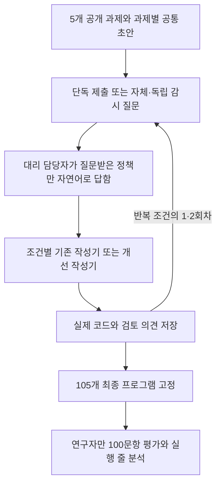

# 새 유형 100문항에서 인간 개입 파이프라인 21조건 비교

새 과제 5개의 100문항에서 메인 단독은 **33/100**, 현재 메인 자체 검토 3회차는 **68/100**, 현재 감시자 A·B·C 3회차는 **81/100**이었다. 같은 모델과 시드로 21조건, 최종 프로그램 105개를 고정한 뒤 채점했다.

공개 명세가 충분한 부분과 담당자에게 물어야 하는 정책을 구분했다. 각 과제의 초안은 공유했고, 같은 첫 질문을 사용하는 작성 방식에는 같은 회신을 제공했다. 반복 조건은 실제 직전 코드에서 다음 질문을 생성했다. 중간 채점 결과는 모델에 전달하지 않았다. [설계와 비교 범위](PROTOCOL.md) · 고정한 조건 (로컬 보관 자료) · 최종 제출 식별값 (로컬 보관 자료)

[8쪽 PDF 보고서](output/pdf/새유형_100문항_파이프라인_비교보고서.pdf) · [핵심 결과와 코드 원인 분석](analysis.md) · 질문·답변별 개선/퇴행 문항 (로컬 보관 자료)

현재 감시자는 단독보다 48점, 현재 자체 검토보다 13점 높았다. 전체 최고는 P4 질문+입력 영역의 82점(37,985토큰)이며 현재 감시자는 81점(104,239토큰)이다. 현재 감시자 오답 19개는 필요한 정책 미확보 상태 13개, 이미 알려진 요구 구현 실패 6개로 나뉜다. 최신 구조의 일괄 우위나 답변 반영의 완전 보장을 주장하지 않는다.

## 과제와 표본

일정이나 상태 전이가 없는 순수 함수 5개다. 문자열 범위를 제한하고 작은 정수 비교를 사용해 계산 부담을 줄였다. 100문항은 100개의 독립 개발 프로젝트가 아니라 **5개 프로그램에 대한 서로 다른 입력 100개**다. 이전 20문항과 난이도가 다르므로 총점의 직접 증감을 구조 개선량으로 해석하지 않는다.
| 과제 | 입력 수 | 세부 유형 |
|---|---|---|
| 표시 제목 정리 | 20 | 공개 기본 변환 · 연속 내부 공백 · 빈 제목 · 하이픈 보존 · 변환 결합 |
| 파일 확장자 추출 | 20 | 공개 기본 추출 · 확장자 대소문자 · 여러 점 · 숨김 이름 · 확장자 없음 |
| 식별코드 가림 | 20 | 일반 코드 · 세 글자 경계 · 짧은 코드 · 빈 코드 · 길이·표기 보존 |
| 업로드 크기 허용 | 20 | 음수 입력 · 빈 파일 · 상한 아래 · 상한 일치 · 상한 초과 |
| 인쇄 영역 허용 | 20 | 공개 음수 거부 · 0인 길이 · 영역 내부 · 상한 선·모서리 · 초과·고정 방향 |

입력·기대값·정책 의존성은 최초 추론 전에 고정했다. 빈 식별코드처럼 결과 길이 보존만으로 답을 알 수 있는 입력은 공개 정보만으로 결정되는 문항으로 취급했다. [전체 문항](problem-set.md) · 원문 평가 데이터 (로컬 보관 자료)

## 전체 파이프라인 결과

보류와 반환 형식 오류는 점수 0으로 집계했다. 정책 미수신 반환은 필요한 운영 답을 받기 전에 값을 반환한 횟수이며 우연히 맞힌 경우도 포함한다. 토큰 표는 각 조건을 단독 실행할 때 필요한 초안·질문·작성·최종 검토·재시도 호출의 입력+출력 사용량을 합친 것이다. 공유 요청에는 저장된 실제 호출의 사용량을 계상했다. 이번 실행의 중복 제거 실소모는 아래 비용 절에 따로 제시한다.
| 조건 | 정답 /100 | 오답 | 보류·오류 | 정책 미수신 반환 | 질문 | 누적 토큰 |
|---|---|---|---|---|---|---|
| ① 메인 단독 | 33 | 27 | 40 | 51 | 0 | 3,468 |
| ② 자체 검토·기존 작성 | 54 | 26 | 20 | 34 | 5 | 14,342 |
| ③ P1 공통 관점 감시자 | 54 | 26 | 20 | 25 | 15 | 27,341 |
| ③ P2 관점 분담 | 33 | 27 | 40 | 25 | 15 | 26,711 |
| ③ P3 상황·두 결과 | 65 | 35 | 0 | 26 | 14 | 33,099 |
| ③ P4 질문 정리·줄 인용 | 76 | 24 | 0 | 17 | 14 | 33,439 |
| ③ P4 적용 근거 확인 | 46 | 34 | 20 | 17 | 14 | 33,439 |
| ③ a 질문 개선·기존 작성 | 57 | 23 | 20 | 20 | 9 | 30,446 |
| ② 자체 질문·일반 코드 | 48 | 52 | 0 | 47 | 5 | 17,158 |
| ② 자체 질문·자유 조건식 | 39 | 41 | 20 | 36 | 5 | 18,767 |
| ② 자체 질문·입력 영역 | 48 | 52 | 0 | 47 | 5 | 16,929 |
| ③ b 기존 질문·일반 코드 | 80 | 20 | 0 | 17 | 14 | 36,496 |
| ③ b 기존 질문·자유 조건식 | 60 | 20 | 20 | 17 | 14 | 41,497 |
| ③ b 기존 질문·입력 영역 | 82 | 18 | 0 | 17 | 14 | 37,985 |
| ③ a+b 일반 코드 | 76 | 16 | 8 | 31 | 9 | 33,761 |
| ③ a+b 자유 조건식 | 25 | 0 | 75 | 0 | 9 | 34,818 |
| ③ a+b 입력 영역 | 76 | 16 | 8 | 31 | 9 | 33,761 |
| ② 이전 구조·3회차 | 63 | 37 | 0 | 16 | 15 | 46,297 |
| ③ 이전 구조·3회차 | 79 | 21 | 0 | 21 | 35 | 106,117 |
| ② 현재 구조·3회차 | 68 | 32 | 0 | 47 | 15 | 46,020 |
| ③ 현재 구조·3회차 | 81 | 19 | 0 | 21 | 28 | 104,239 |

[전체 입력·출력 토큰과 호출 횟수](research/summary.csv) · [과제별 결과·작성 형식·실패 기록](research/by-project.csv)

초기 중간 채점 노출 실험과 예약 전용 후보 선택 A/B/C/D는 이번 규정·과제 범위와 맞지 않아 제외했다. P1은 공통 관점, P2는 역할 분담, P3는 서로 다른 두 결과의 상황 기록, P4는 감시자 C의 질문 정리와 메인의 답·줄 인용이다. a는 두 가능한 규칙을 비교하는 질문 개선, b는 받은 답을 코드로 옮기는 작성 방식의 변경이다.

## 문제 유형별 비교

| 과제 / 유형 | 문항 수 | 단독 | 자체 1회 | P2 | P4 보완 | a+b 1회 | 이전 다중 3회 | 현재 자체 3회 | 현재 다중 3회 |
|---|---|---|---|---|---|---|---|---|---|
| 표시 제목 정리 / 공개 기본 변환 | 5 | 5 | 5 | 5 | 5 | 5 | 5 | 5 | 4 |
| 표시 제목 정리 / 연속 내부 공백 | 4 | 4 | 4 | 4 | 4 | 4 | 4 | 4 | 3 |
| 표시 제목 정리 / 빈 제목 | 3 | 0 | 0 | 0 | 0 | 3 | 3 | 0 | 3 |
| 표시 제목 정리 / 하이픈 보존 | 4 | 0 | 0 | 0 | 0 | 4 | 4 | 4 | 3 |
| 표시 제목 정리 / 변환 결합 | 4 | 0 | 0 | 0 | 0 | 4 | 4 | 1 | 2 |
| 파일 확장자 추출 / 공개 기본 추출 | 4 | 0 | 0 | 0 | 4 | 0 | 0 | 4 | 4 |
| 파일 확장자 추출 / 확장자 대소문자 | 4 | 0 | 0 | 0 | 0 | 0 | 0 | 0 | 0 |
| 파일 확장자 추출 / 여러 점 | 4 | 0 | 0 | 0 | 3 | 3 | 0 | 3 | 3 |
| 파일 확장자 추출 / 숨김 이름 | 4 | 0 | 0 | 0 | 1 | 2 | 2 | 1 | 2 |
| 파일 확장자 추출 / 확장자 없음 | 4 | 0 | 0 | 0 | 4 | 4 | 4 | 4 | 4 |
| 식별코드 가림 / 일반 코드 | 5 | 0 | 5 | 0 | 0 | 5 | 5 | 5 | 5 |
| 식별코드 가림 / 세 글자 경계 | 4 | 4 | 0 | 4 | 4 | 4 | 4 | 0 | 4 |
| 식별코드 가림 / 짧은 코드 | 5 | 5 | 0 | 5 | 5 | 5 | 5 | 0 | 5 |
| 식별코드 가림 / 빈 코드 | 1 | 1 | 1 | 1 | 1 | 1 | 1 | 1 | 1 |
| 식별코드 가림 / 길이·표기 보존 | 5 | 0 | 5 | 0 | 0 | 5 | 5 | 5 | 5 |
| 업로드 크기 허용 / 음수 입력 | 4 | 0 | 4 | 0 | 0 | 4 | 4 | 4 | 4 |
| 업로드 크기 허용 / 빈 파일 | 1 | 0 | 1 | 0 | 0 | 1 | 1 | 1 | 1 |
| 업로드 크기 허용 / 상한 아래 | 7 | 0 | 7 | 0 | 0 | 7 | 7 | 7 | 7 |
| 업로드 크기 허용 / 상한 일치 | 1 | 0 | 1 | 0 | 0 | 1 | 1 | 1 | 1 |
| 업로드 크기 허용 / 상한 초과 | 7 | 0 | 7 | 0 | 0 | 0 | 0 | 7 | 0 |
| 인쇄 영역 허용 / 공개 음수 거부 | 3 | 3 | 3 | 3 | 3 | 3 | 3 | 0 | 3 |
| 인쇄 영역 허용 / 0인 길이 | 3 | 3 | 3 | 3 | 3 | 3 | 3 | 3 | 3 |
| 인쇄 영역 허용 / 영역 내부 | 3 | 3 | 3 | 3 | 3 | 3 | 3 | 3 | 3 |
| 인쇄 영역 허용 / 상한 선·모서리 | 5 | 5 | 5 | 5 | 0 | 5 | 5 | 5 | 5 |
| 인쇄 영역 허용 / 초과·고정 방향 | 6 | 0 | 0 | 0 | 6 | 0 | 6 | 0 | 6 |

표의 각 칸은 해당 유형에서 맞힌 문항 수다. 21조건 전체의 세부 유형과 빈 입력·경계·예외·결합 같은 공통 특성 집계도 제공한다. [21조건 유형별 집계](research/by-type.csv) · 공통 특성별 집계 (로컬 보관 자료)

## 정보 확보와 구현이 끊긴 지점

문항별로 사전에 표시한 필요한 정책과 실제 회신을 대조했다. 이 지표는 같은 출력이 다른 근거로도 결정될 수 있는 모든 자연어 해석을 증명하는 지표는 아니다. 인쇄 두 축이 모두 초과하면 어느 한 축의 상한만 알아도 거부를 정할 수 있는 대체 근거를 인정했다.
| 조건 | 공개 요구 실패 | 답 확보 후 실패 | 답 미수신 오답 | 답 미수신 보류 | 답 미수신 정답 |
|---|---|---|---|---|---|
| ① 메인 단독 | 8 | 0 | 27 | 32 | 24 |
| ② 자체 검토·기존 작성 | 4 | 7 | 22 | 13 | 12 |
| ③ P1 공통 관점 감시자 | 4 | 20 | 16 | 6 | 9 |
| ③ P2 관점 분담 | 8 | 52 | 7 | 0 | 18 |
| ③ P3 상황·두 결과 | 0 | 18 | 17 | 0 | 9 |
| ③ P4 질문 정리·줄 인용 | 0 | 8 | 16 | 0 | 1 |
| ③ P4 적용 근거 확인 | 4 | 34 | 16 | 0 | 1 |
| ③ a 질문 개선·기존 작성 | 4 | 12 | 12 | 15 | 8 |
| ② 자체 질문·일반 코드 | 0 | 17 | 35 | 0 | 12 |
| ② 자체 질문·자유 조건식 | 5 | 17 | 28 | 11 | 8 |
| ② 자체 질문·입력 영역 | 0 | 17 | 35 | 0 | 12 |
| ③ b 기존 질문·일반 코드 | 1 | 4 | 15 | 0 | 2 |
| ③ b 기존 질문·자유 조건식 | 2 | 23 | 15 | 0 | 2 |
| ③ b 기존 질문·입력 영역 | 1 | 4 | 13 | 0 | 4 |
| ③ a+b 일반 코드 | 4 | 1 | 15 | 4 | 16 |
| ③ a+b 자유 조건식 | 8 | 32 | 0 | 35 | 0 |
| ③ a+b 입력 영역 | 4 | 1 | 15 | 4 | 16 |
| ② 이전 구조·3회차 | 0 | 21 | 16 | 0 | 0 |
| ③ 이전 구조·3회차 | 4 | 4 | 13 | 0 | 8 |
| ② 현재 구조·3회차 | 3 | 0 | 29 | 0 | 18 |
| ③ 현재 구조·3회차 | 1 | 5 | 13 | 0 | 8 |

문항별 근거 충족·반환값·실행된 줄 (로컬 보관 자료) · 입력별 전체 비교 (로컬 보관 자료)

## 세 회차의 변화

| 조건 | 회차 | 정답 /100 | 누적 질문 | 누적 토큰 | 정책 미수신 반환 |
|---|---|---|---|---|---|
| ② 이전 구조·3회차 | 1 | 48 | 5 | 16,929 | 47 |
| ② 이전 구조·3회차 | 2 | 63 | 10 | 31,065 | 24 |
| ② 이전 구조·3회차 | 3 | 63 | 15 | 46,297 | 16 |
| ③ 이전 구조·3회차 | 1 | 76 | 9 | 33,761 | 31 |
| ③ 이전 구조·3회차 | 2 | 79 | 23 | 68,067 | 21 |
| ③ 이전 구조·3회차 | 3 | 79 | 35 | 106,117 | 21 |
| ② 현재 구조·3회차 | 1 | 71 | 5 | 17,376 | 47 |
| ② 현재 구조·3회차 | 2 | 71 | 10 | 31,129 | 47 |
| ② 현재 구조·3회차 | 3 | 68 | 15 | 46,020 | 47 |
| ③ 현재 구조·3회차 | 1 | 74 | 9 | 34,353 | 35 |
| ③ 현재 구조·3회차 | 2 | 74 | 19 | 67,252 | 35 |
| ③ 현재 구조·3회차 | 3 | 81 | 28 | 104,239 | 21 |

세 번째 제출을 최종 성능으로 사용했다. 1·2회차는 모두 종료한 뒤 사본으로 평가했다. 회차별 신규 정책과 반복 회신은 질문 기록에서 확인할 수 있다. [모든 질문·담당자 답·선택 근거](research/questions.md) · 회차별 정책 확보 (로컬 보관 자료)

## 질문과 답변의 실제 흐름



담당자는 사전에 고정한 정책 카드에서 실제 질문에 필요한 문장만 선택했고, 코드와 점수에 맞춰 새 규칙을 만들지 않았다. 직접 사용자의 응답은 0회이며 사용자의 위임을 받은 연구 진행자가 대리 응답했다. 질문에 없는 정책은 다음 회차에서 물을 때까지 전달하지 않았다. 같은 질문의 정책은 반복 회신했다.

## 실험 비용과 재현 범위

전체 기록의 고유 모델 호출은 **523회**, 입력 **317,539토큰**, 출력 **94,802토큰**, 합계 **412,341토큰**이다. 기록된 모델 응답 시간의 합은 59.3분이다. 이는 대리 담당자의 판단·개발·대기 시간을 포함한 전체 경과 시간과 다르다.

조건별 표에는 공유한 호출의 원래 측정 비용을 각 조건에 넣었다. 전체 실소모에서는 같은 요청을 한 번만 센다. 응답 없이 끊긴 로컬 전송의 사용량은 계측되지 않았으므로 위 합계의 한계로 남긴다. 연결 장애와 서버 로그는 별도로 보관했다. 전송 기록 (로컬 보관 자료) · 채점 산출물 식별값 (로컬 보관 자료)

시드 하나와 5개 과제의 결과다. 총 질문 기회와 토큰 상한을 구조끼리 동일하게 맞춘 비교는 아니다. 이번 표본의 문항 수와 점수만으로 모든 과제에 대한 통계적 우위를 주장할 수 없다. 자유 조건식의 표현 범위, 입력 영역 방식이 일반 코드 경로로 전환되는 경우, 담당자 답을 적용하는 의미 해석의 실패도 결과에 포함했다.

기존 파이프라인 구현을 고정해 재사용했다. 신규 실행기는 공개 자료만 요청에 넣고, 신규 채점기는 모든 제출의 고정 여부를 확인한 뒤 별도로 실행한다. 핵심 자료는 공개 명세, 운영 정책, 원시 호출, 질문과 회신, 모든 회차 코드, 문항별 실행 줄과 비용이다.

```sh
python3 -B -m experiments.transfer100_study pending
python3 -B -m experiments.transfer100_execute
python3 -B -m experiments.transfer100_study report
```
